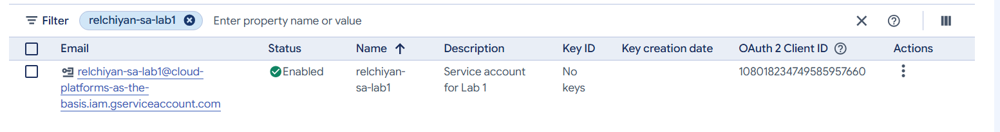
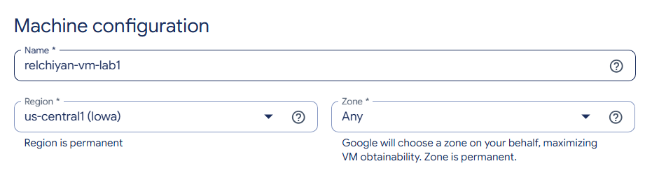
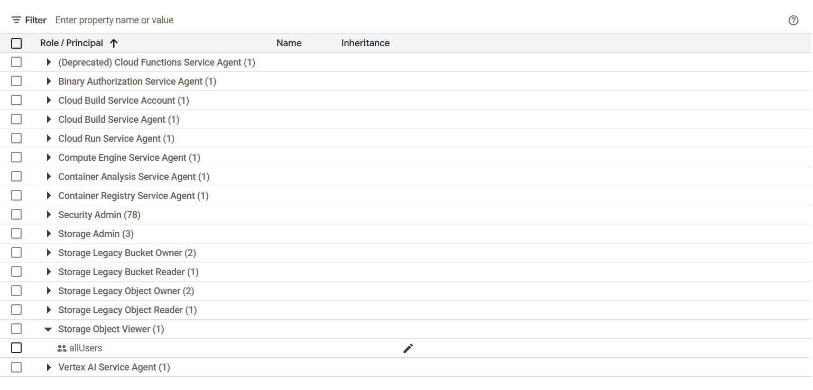

# Лабораторная работа № 1. Обзор Google Cloud и исследование основных сервисов

University: [ITMO University](https://itmo.ru/ru/)  
Faculty: [FICT](https://fict.itmo.ru/)  
Course: [Cloud platforms as the basis of technology entrepreneurship](https://ex-itmo-ict-faculty.github.io/cloud-platforms-as-the-basis-of-technology-entrepreneurship/)  
Year: 2026/2027  
Group: U4225  
Author: Elchiyan Roman Romanovich  
Lab: Lab1  
Date of create: 01.10.2026  
Date of finished: 06.11.2026

## 1. Цель и задание

Цель работы — изучить управление доступом и базовыми ресурсами Google Cloud на примере сервисного аккаунта, виртуальной машины Compute Engine и бакета Cloud Storage.

По [заданию лабораторной № 1](https://ex-itmo-ict-faculty.github.io/cloud-platforms-as-the-basis-of-technology-entrepreneurship/education/labs2023-2024/lab1/lab1/) необходимо создать сервисный аккаунт с ролью `Storage Admin`, запустить виртуальную машину `e2-micro` в режиме Spot, скопировать три файла из бакета `lab1-bucket-itmo`, затем заменить роль аккаунта на `Compute Viewer` и повторить копирование. После проверки созданные ресурсы нужно удалить.

Работа выполнялась в учебном проекте Google Cloud `cloud-platforms-as-the-basis` через Cloud Console и SSH-терминал виртуальной машины.

## 2. Создание сервисного аккаунта

В разделе **IAM & Admin → Service Accounts** создан сервисный аккаунт `relchiyan-sa-lab1`. Название соответствует шаблону из задания: первая буква имени, фамилия и суффикс `-sa-lab1`.

| Параметр | Значение |
| --- | --- |
| Имя | `relchiyan-sa-lab1` |
| Адрес | `relchiyan-sa-lab1@cloud-platforms-as-the-basis.iam.gserviceaccount.com` |
| Описание | `Service account for Lab 1` |
| Начальная роль | `Storage Admin` (`roles/storage.admin`) |

Аккаунт создан в активном состоянии (`Enabled`). На уровне проекта ему назначена роль `Storage Admin`, предоставляющая управление бакетами и объектами Cloud Storage.



*Рисунок 1 — Сервисный аккаунт в списке Service Accounts.*


*Рисунок 2 — Назначение роли Storage Admin сервисному аккаунту.*

## 3. Создание виртуальной машины Compute Engine

В разделе **Compute Engine → VM instances** создана виртуальная машина со следующими параметрами:

| Параметр | Значение |
| --- | --- |
| Имя | `relchiyan-vm-lab1` |
| Регион | `us-central1` (Iowa) |
| Зона после создания | `us-central1-c` |
| Тип машины | `e2-micro` |
| Оперативная память | 1 ГБ |
| Модель предоставления ресурсов | `Spot` |
| Сервисный аккаунт VM | `relchiyan-sa-lab1` |
| Access scopes | `Allow full access to all Cloud APIs` |

Режим Spot выбран по требованию задания. Такая машина может быть остановлена Google Cloud при необходимости высвобождения ресурсов. Установка полных API scopes сама по себе не предоставляет прав: операции дополнительно проверяются через IAM-роли сервисного аккаунта.



*Рисунок 3 — Имя и регион создаваемой VM.*


*Рисунок 4 — Тип e2-micro и модель предоставления ресурсов Spot.*


*Рисунок 5 — Выбор сервисного аккаунта и диапазона API-доступа.*

После создания VM получила статус работающей машины; Google Cloud назначил ей зону `us-central1-c`. Подключение выполнялось через кнопку **SSH** в Cloud Console. На машине использовалась Debian GNU/Linux.


*Рисунок 6 — Запущенная VM relchiyan-vm-lab1 в Compute Engine.*

## 4. Проверка доступа к Cloud Storage и копирование файлов

### 4.1. Учетные данные и содержимое бакета

В SSH-терминале проверен активный аккаунт Google Cloud CLI и запрошен список объектов учебного бакета:

```bash
gcloud auth list
gcloud storage ls gs://lab1-bucket-itmo/
```

Активным оказался сервисный аккаунт `relchiyan-sa-lab1@cloud-platforms-as-the-basis.iam.gserviceaccount.com`. Команда `gcloud storage ls` вывела три объекта:

```text
gs://lab1-bucket-itmo/pic1.jpg
gs://lab1-bucket-itmo/pic2.jpg
gs://lab1-bucket-itmo/pic3.jpeg
```


*Рисунок 7 — Проверка активного аккаунта и содержимого бакета.*

### 4.2. Первое копирование при роли Storage Admin

Создана локальная папка `~/lab1-files`, в которую скопированы объекты бакета. Затем командой `ls -lah` проверено наличие файлов:

```bash
mkdir -p ~/lab1-files
gcloud storage cp gs://lab1-bucket-itmo/* ~/lab1-files/
ls -lah ~/lab1-files/
```

Команда копирования завершилась сообщением `Completed files 3/3`. В каталоге `/home/rel70452/lab1-files/` находились:

| Файл | Размер по `ls -lah` |
| --- | ---: |
| `pic1.jpg` | 228K |
| `pic2.jpg` | 487K |
| `pic3.jpeg` | 858K |

Общий объем передачи, указанный `gcloud`, составил около 1,5 MiB. Наличие файлов подтверждено выводом `ls -lah`.


*Рисунок 8 — Копирование трех файлов при роли Storage Admin и проверка локального каталога.*

## 5. Замена роли и повторная проверка

В IAM роль сервисного аккаунта изменена с `Storage Admin` (`roles/storage.admin`) на `Compute Viewer` (`roles/compute.viewer`). Роль `Compute Viewer` позволяет просматривать сведения о ресурсах Compute Engine и **не предоставляет** права на чтение объектов Cloud Storage.


*Рисунок 9 — Сервисный аккаунт после замены роли на Compute Viewer.*

Для повторной проверки файлы копировались в отдельную папку, чтобы не использовать результаты первой операции:

```bash
mkdir -p ~/lab1-files-viewer
gcloud storage cp gs://lab1-bucket-itmo/* ~/lab1-files-viewer/
ls -lah ~/lab1-files-viewer/
```

**Фактический результат:** все три файла снова успешно скопированы (`Completed files 3/3`), несмотря на замену роли. Повторное выполнение исходной команды копирования также прошло без ошибки. Следовательно, наличие файлов во второй папке не объясняется использованием результатов первого скачивания.


*Рисунок 10 — Повторное копирование трех объектов при роли Compute Viewer.*

## 6. Проверка причины успешного копирования

### 6.1. Запросы без авторизации Google

Чтобы установить, доступны ли объекты независимо от учетных данных сервисного аккаунта, выполнены прямые HTTP-запросы через `curl`. Команда не передает токен Google или другие учетные данные:

```bash
for file in pic1.jpg pic2.jpg pic3.jpeg; do
    echo "=== $file ==="
    curl -sS -L -o /dev/null \
        -w "HTTP: %{http_code}\nSize: %{size_download} bytes\nContent-Type: %{content_type}\n" \
        "https://storage.googleapis.com/lab1-bucket-itmo/$file"
    echo
done
```

Результаты проверки:

| Объект | HTTP-статус | Размер ответа | Content-Type |
| --- | ---: | ---: | --- |
| `pic1.jpg` | `200` | 233 289 байт | `image/jpeg` |
| `pic2.jpg` | `200` | 498 260 байт | `image/jpeg` |
| `pic3.jpeg` | `200` | 878 482 байта | `image/jpeg` |

Все три объекта были доступны по прямым URL без авторизации. Это подтвердило публичный доступ к содержимому файлов.


*Рисунок 11 — HTTP 200 для всех трех файлов без передачи учетных данных.*

### 6.2. Проверка настроек IAM самого бакета

В Cloud Console открыта вкладка **Cloud Storage → Buckets → lab1-bucket-itmo → Permissions**. В свойствах бакета указано:

- `Public access: Access granted to public principals` — на уровне бакета существуют разрешения для публичных субъектов.
- `Access control: Uniform` — индивидуальные ACL объектов отключены; права определяются IAM-политикой бакета.


*Рисунок 12 — Публичный доступ и режим Uniform bucket-level access.*

В перечне разрешений бакета обнаружена запись `allUsers` с ролью `Storage Object Viewer`. В отличие от роли `Compute Viewer`, эта роль предоставляет чтение объектов Cloud Storage, а субъект `allUsers` включает в том числе неавторизованных пользователей.



*Рисунок 13 — Запись allUsers с ролью Storage Object Viewer в политике бакета.*

Таким образом, сохранение доступа после замены `Storage Admin` на `Compute Viewer` объясняется **IAM-политикой общего учебного бакета**, а не правами `Compute Viewer`. При обращении к публичному объекту разрешение `allUsers` действует независимо от персональных разрешений сервисного аккаунта. Изменения в политике общего бакета не вносились.

## 7. Удаление созданных ресурсов

После завершения проверки из учебного проекта удалены созданные для этой работы ресурсы:

- виртуальная машина `relchiyan-vm-lab1`;
- сервисный аккаунт `relchiyan-sa-lab1`.

Общий учебный бакет `lab1-bucket-itmo` и его разрешения не изменялись. Удаление выполнено через Google Cloud Console.

## 8. Вывод

В работе создан сервисный аккаунт, настроена виртуальная машина Compute Engine в режиме Spot, проверена авторизация Google Cloud CLI и выполнено копирование объектов Cloud Storage на VM. После изменения IAM-роли сервисного аккаунта с `Storage Admin` на `Compute Viewer` копирование файлов осталось доступным.

Причина установлена дополнительной проверкой: все три файла отдаются по HTTP без авторизации, а в IAM-политике бакета `lab1-bucket-itmo` субъекту `allUsers` назначена роль `Storage Object Viewer`. Поэтому этот эксперимент **не показывает**, что `Compute Viewer` позволяет скачивать объекты из закрытых бакетов. Он показывает, что итоговый доступ определяется совокупностью действующих разрешений, в том числе разрешениями на уровне самого ресурса.

Созданные для лабораторной ресурсы удалены после завершения работы.