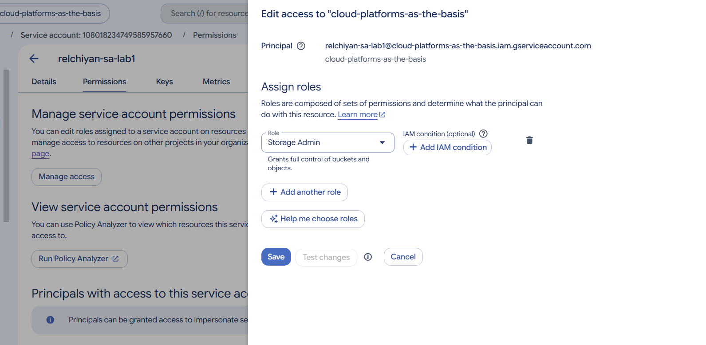
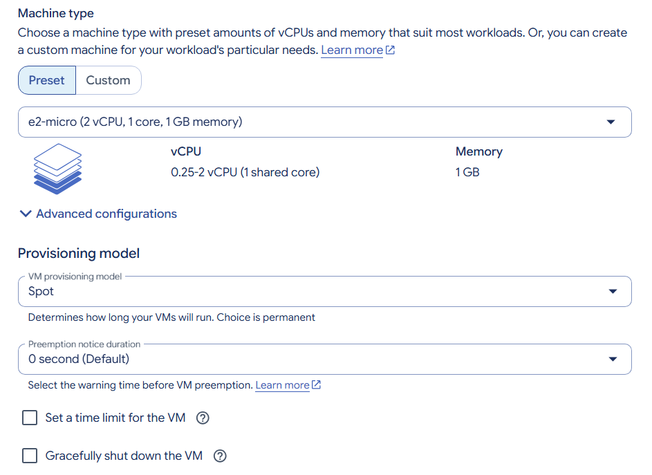
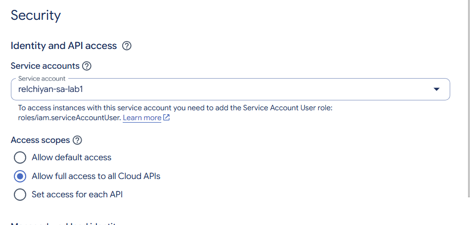
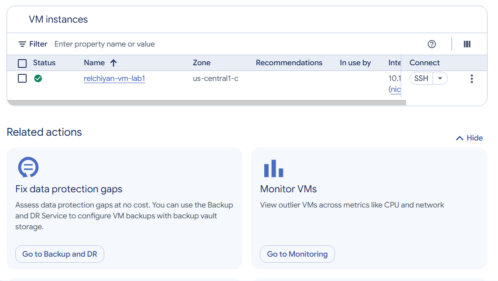
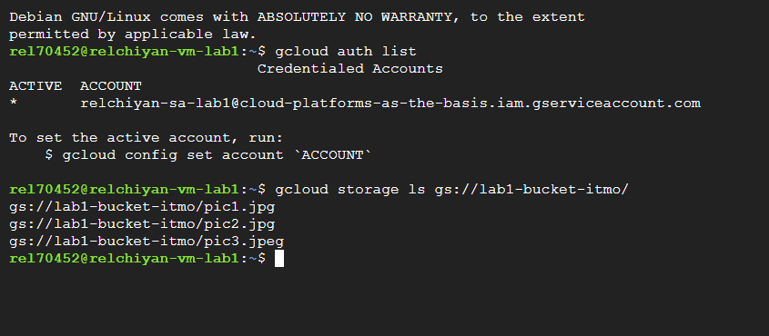
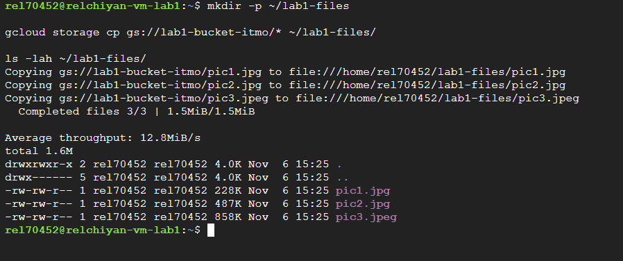
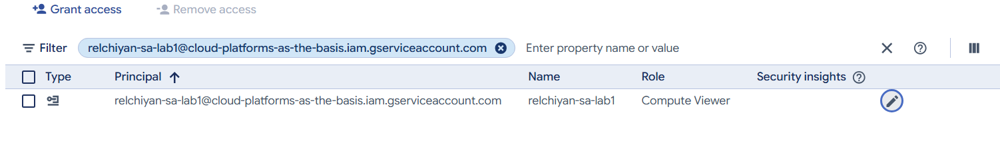
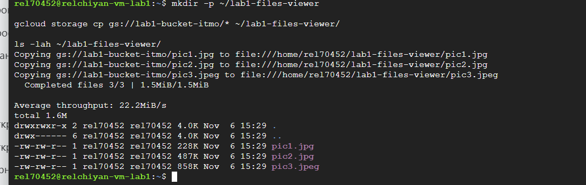
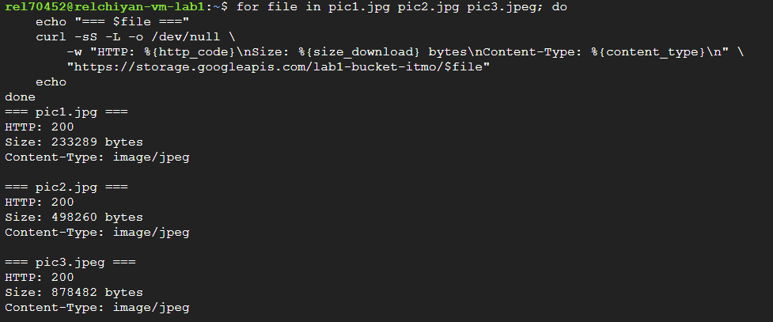
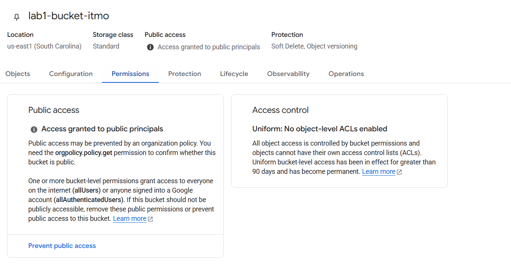

# Лабораторная работа № 1. Обзор Google Cloud и исследование основных сервисов

University: [ITMO University](https://itmo.ru/ru/)  
Faculty: [FICT](https://fict.itmo.ru/)  
Course: [Cloud platforms as the basis of technology entrepreneurship](https://ex-itmo-ict-faculty.github.io/cloud-platforms-as-the-basis-of-technology-entrepreneurship/)  
Year: 2026/2027  
Group: U4225  
Author: Elchiyan Roman Romanovich  
Lab: Lab1  
Date of create: 01.10.2026  
Date of finished: 06.11.2026

## 1. Цель работы

Проверить доступ виртуальной машины Compute Engine к объектам Cloud Storage до и после смены IAM-роли сервисного аккаунта. [Задание лабораторной работы № 1](https://ex-itmo-ict-faculty.github.io/cloud-platforms-as-the-basis-of-technology-entrepreneurship/education/labs2023-2024/lab1/lab1/)

## 2. Настройка сервисного аккаунта и виртуальной машины

В проекте `cloud-platforms-as-the-basis` создан сервисный аккаунт `relchiyan-sa-lab1@cloud-platforms-as-the-basis.iam.gserviceaccount.com`. На уровне проекта ему назначена роль `Storage Admin` (`roles/storage.admin`).



*Рисунок 1 — Назначение роли Storage Admin сервисному аккаунту.*

В Compute Engine создана виртуальная машина со следующими параметрами.

| Параметр | Значение |
| --- | --- |
| Имя | `relchiyan-vm-lab1` |
| Регион и зона | `us-central1`, `us-central1-c` |
| Тип машины | `e2-micro`, 1 ГиБ оперативной памяти |
| Модель предоставления ресурсов | `Spot` |
| Операционная система | Debian GNU/Linux |
| Сервисный аккаунт | `relchiyan-sa-lab1` |
| Область доступа | `Allow full access to all Cloud APIs` |



*Рисунок 2 — Тип виртуальной машины и модель предоставления ресурсов.*



*Рисунок 3 — Сервисный аккаунт и область доступа виртуальной машины.*

После запуска виртуальной машины подключение выполнено по SSH через Google Cloud Console.



*Рисунок 4 — Запущенная виртуальная машина в зоне us-central1-c.*

## 3. Копирование объектов при роли Storage Admin

В SSH-сеансе `gcloud auth list` подтвердил использование аккаунта `relchiyan-sa-lab1`. В бакете `lab1-bucket-itmo` доступны три объекта — `pic1.jpg`, `pic2.jpg` и `pic3.jpeg`.



*Рисунок 5 — Активный аккаунт Google Cloud CLI и содержимое бакета.*

```bash
mkdir -p ~/lab1-files
gcloud storage cp gs://lab1-bucket-itmo/* ~/lab1-files/
ls -lah ~/lab1-files/
```

Все три объекта скопированы в `~/lab1-files/`.



*Рисунок 6 — Результат копирования и содержимое локального каталога.*

## 4. Повторное копирование при роли Compute Viewer

В IAM проекта роль сервисного аккаунта заменена на `Compute Viewer` (`roles/compute.viewer`).



*Рисунок 7 — Роль сервисного аккаунта после изменения.*

```bash
mkdir -p ~/lab1-files-viewer
gcloud storage cp gs://lab1-bucket-itmo/* ~/lab1-files-viewer/
ls -lah ~/lab1-files-viewer/
```

После смены роли все три объекта скопированы в отдельный каталог `~/lab1-files-viewer/`.



*Рисунок 8 — Результат повторного копирования в отдельный каталог.*

## 5. Проверка публичного доступа

Публичный доступ проверен запросами `GET` по прямым URL без авторизации.

```bash
for file in pic1.jpg pic2.jpg pic3.jpeg; do
    echo "=== $file ==="
    curl -sS -L -o /dev/null \
        -w "HTTP: %{http_code}\nSize: %{size_download} bytes\nContent-Type: %{content_type}\n" \
        "https://storage.googleapis.com/lab1-bucket-itmo/$file"
    echo
done
```

| Объект | HTTP-статус | Размер ответа, байт | Content-Type |
| --- | --- | ---: | --- |
| `pic1.jpg` | `200` | 233 289 | `image/jpeg` |
| `pic2.jpg` | `200` | 498 260 | `image/jpeg` |
| `pic3.jpeg` | `200` | 878 482 | `image/jpeg` |



*Рисунок 9 — Результат проверки доступа к объектам без авторизации.*

В бакете действовал режим `Uniform bucket-level access`. Политика IAM бакета предоставляла субъекту `allUsers` роль `Storage Object Viewer` (`roles/storage.objectViewer`), разрешающую перечисление и чтение объектов. [Документация Cloud Storage](https://docs.cloud.google.com/storage/docs/access-control/making-data-public)



*Рисунок 10 — Настройки доступа к учебному бакету.*

## 6. Удаление ресурсов

После завершения проверки через Google Cloud Console удалены виртуальная машина `relchiyan-vm-lab1` и сервисный аккаунт `relchiyan-sa-lab1`.

## 7. Вывод

Роль `Compute Viewer`, назначенная вместо `Storage Admin`, не предоставляет прав на чтение объектов Cloud Storage. Чтение объектов осталось доступным благодаря отдельному разрешению `Storage Object Viewer` для `allUsers` на уровне бакета. Публичный доступ подтверждён ответами `HTTP 200` для всех трёх объектов без авторизации.
