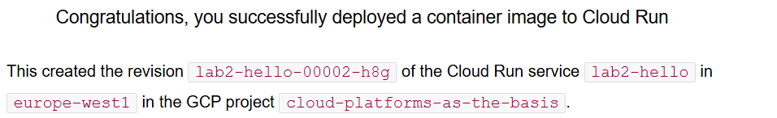
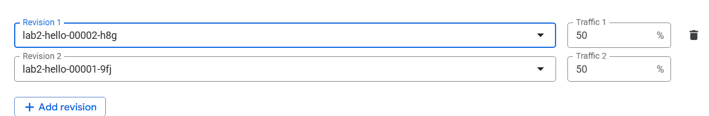
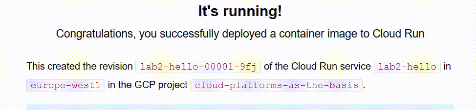
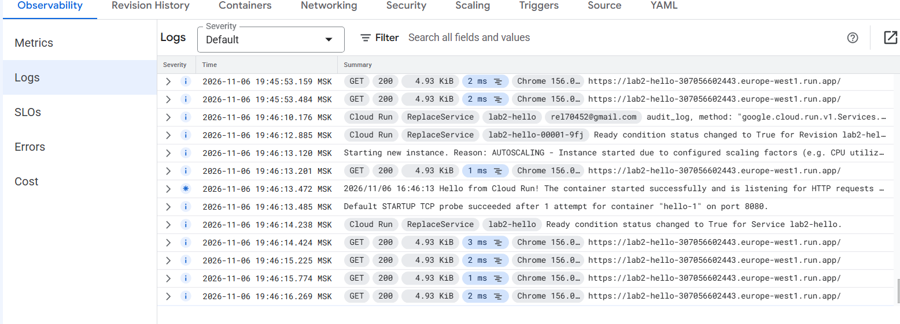
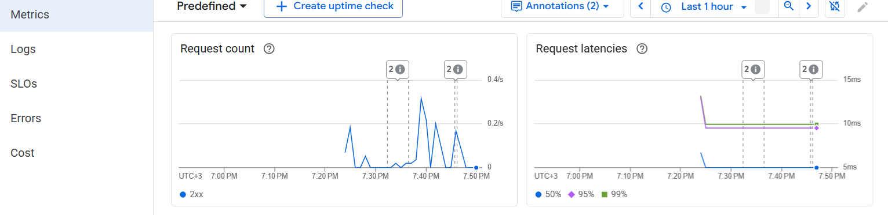
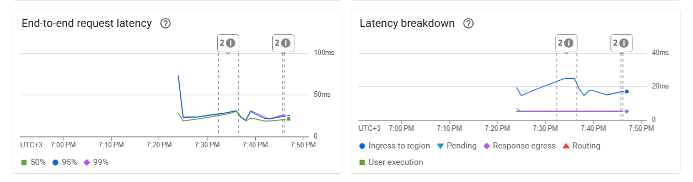

# Лабораторная работа №2. Исследование Cloud Run

University: [ITMO University](https://itmo.ru/ru/)\
Faculty: [FICT](https://fict.itmo.ru/)\
Course: [Cloud platforms as the basis of technology entrepreneurship](https://github.com/ex-itmo-ict-faculty/cloud-platforms-as-the-basis-of-technology-entrepreneurship)\
Year: 2026/2027\
Group: U4225\
Author: Elchiyan Roman Romanovich\
Lab: Lab2\
Date of create: 01.11.2026\
Date of finished: 06.11.2026

## Цель работы

Развернуть контейнерное приложение в Google Cloud Run, проверить его доступность, изучить логи и метрики, а затем изменить порт контейнера и проверить распределение трафика между ревизиями.

## Развёртывание и проверка доступности

В Google Cloud Console в проекте `cloud-platforms-as-the-basis` создан сервис `lab2-hello` на базе стандартного образа `us-docker.pkg.dev/cloudrun/container/hello`.

| Параметр | Значение |
| --- | --- |
| Регион | `europe-west1` (Бельгия) |
| CPU | 1 vCPU |
| Память | 128 MiB |
| Максимальное число экземпляров | 1 |
| Исходный порт контейнера | `8080` |

После развёртывания ревизия `lab2-hello-00001-9fj` перешла в состояние **Ready**. По адресу `https://lab2-hello-307056602443.europe-west1.run.app` открылась страница Hello. Название ревизии на странице позволило определить, какая версия обслужила запрос.

## Первоначальные логи и метрики

После тестовых запросов в разделе **Observability → Logs** наблюдались записи `GET` со статусом HTTP `200`. Длительность отдельных запросов в логах составляла преимущественно 1–12 мс.

В разделе **Observability → Metrics** использовалось окно **Last 30 minutes**. Ниже приведены значения, записанные при первоначальной проверке.

| Показатель | Наблюдение |
| --- | --- |
| Пиковая интенсивность запросов | Около 0,2 запроса/с |
| Задержка запросов | Примерно 5–13 мс |
| Количество экземпляров | От 0 до 1 |
| Загрузка CPU | Примерно 0,5–1% |
| Использование памяти | Примерно 10–12% |

## Изменение порта контейнера

В конфигурации контейнера порт изменён с `8080` на `8090`. После развёртывания появилась ревизия `lab2-hello-00002-h8g` в состоянии **Ready**. При проверке по прежнему URL открылась страница Hello с идентификатором новой ревизии.

Cloud Run передаёт контейнеру настроенный порт через переменную окружения `PORT` и направляет запросы на этот порт. Успешный ответ второй ревизии показывает, что приложение принимало запросы и при новой конфигурации. Порт относится к контейнеру, а публичный HTTPS-адрес принадлежит сервису. [Документация Google Cloud по настройке порта](https://cloud.google.com/run/docs/configuring/services/containers)

*Рисунок 1. Ответ второй ревизии после изменения порта на 8090.*

## Сравнение ревизий и переключение трафика

| Ревизия | Порт контейнера | Состояние при проверке | Результат |
| --- | --- | --- | --- |
| `lab2-hello-00001-9fj` | `8080` | Ready | Страница Hello доступна |
| `lab2-hello-00002-h8g` | `8090` | Ready | Страница Hello доступна по тому же адресу |

В разделе **Revision History → Manage traffic** каждой ревизии назначено по 50% трафика.

*Рисунок 2. Настройка распределения трафика 50/50 между двумя ревизиями.*

При повторных обновлениях страницы по общему адресу появлялись ответы обеих ревизий. Дополнительно весь трафик поочерёдно направлялся на каждую ревизию. В обоих случаях страница Hello открывалась.

*Рисунок 3. При обновлении страницы по одному URL отображаются разные ревизии сервиса.*

## Итоговые логи и метрики

После переключения трафика в журнале видны успешные запросы `GET` со статусом HTTP `200` и длительностью отдельных запросов 1–3 мс. Записи `ReplaceService` отражают обновление сервиса. При обращении к первой ревизии Cloud Run зарегистрировал запуск экземпляра с причиной `AUTOSCALING` и успешную стартовую проверку `STARTUP TCP probe` на порту `8080`. В показанном фрагменте ошибок нет.

*Рисунок 4. Запросы и события сервиса после экспериментов.*

Для итогового просмотра метрик выбрано окно **Last 1 hour**. На графике **Request count** видны ответы класса `2xx` с пиком около 0,3 запроса/с. На графике **Request latencies** медиана держалась около 5 мс, а 95-й и 99-й перцентили после начального всплеска — около 10 мс.

*Рисунок 5. Интенсивность запросов и задержки по перцентилям за последний час.*

Сквозная задержка (**End-to-end request latency**) преимущественно составляла около 15–30 мс. На графике **Latency breakdown** отдельно виден вклад этапа **Ingress to region**. Значения 1–3 мс относятся к отдельным записям журнала, а значения на графиках — к агрегированным метрикам с разными границами измерения. Окна наблюдения различались, поэтому по пикам нельзя выделить влияние порта на производительность.

*Рисунок 6. Сквозная задержка и её составляющие в итоговом окне наблюдения.*

## Результаты и выводы

Развёрнут сервис `lab2-hello` с двумя работающими ревизиями на портах `8080` и `8090`. В режиме 50/50 по одному URL наблюдались ответы обеих ревизий. Направление 100% трафика поочерёдно на каждую из них подтвердило, что обе обслуживали запросы самостоятельно. Адрес сервиса при смене порта контейнера и перераспределении трафика оставался прежним.

После завершения экспериментов сервис `lab2-hello` удалён из Cloud Run.
