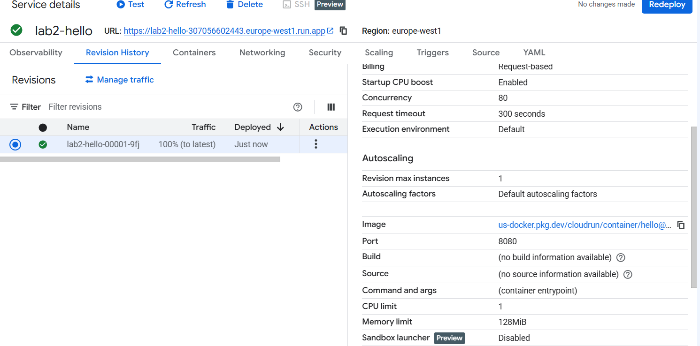
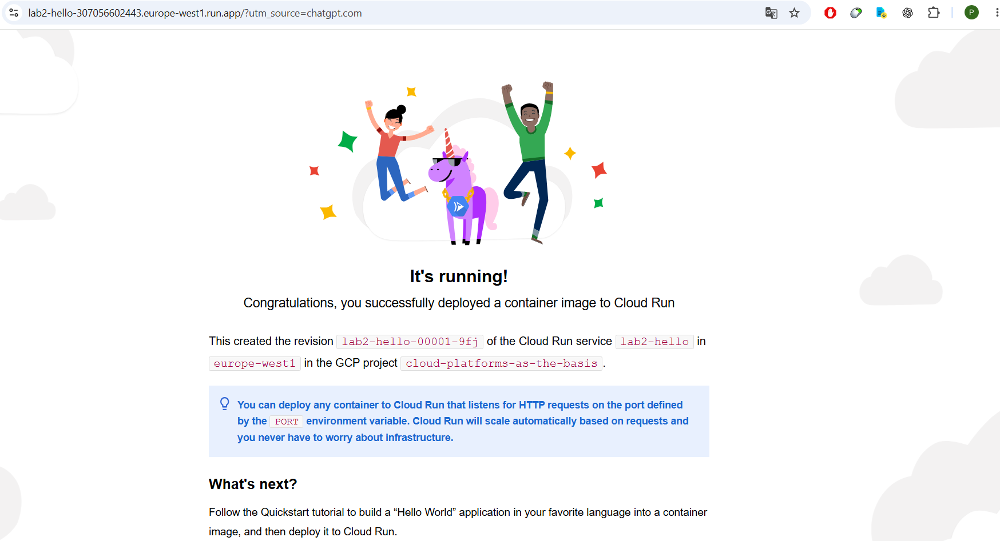

# Лабораторная работа №2. Исследование Cloud Run

University: [ITMO University](https://itmo.ru/ru/)\
Faculty: [FICT](https://fict.itmo.ru/)\
Course: [Cloud platforms as the basis of technology entrepreneurship](https://github.com/ex-itmo-ict-faculty/cloud-platforms-as-the-basis-of-technology-entrepreneurship)\
Year: 2026/2027\
Group: U4225\
Author: Elchiyan Roman Romanovich\
Lab: Lab2\
Date of create: 01.11.2026\
Date of finished: 06.11.2026

## Цель работы

Развернуть контейнерное приложение в Google Cloud Run, проверить его доступность, изучить логи и метрики, а затем изменить порт контейнера и проверить распределение трафика между ревизиями.

## Развёртывание и проверка доступности

В Google Cloud Console в проекте `cloud-platforms-as-the-basis` создан сервис `lab2-hello` на базе стандартного образа `us-docker.pkg.dev/cloudrun/container/hello`.

| Параметр | Значение |
| --- | --- |
| Регион | `europe-west1` (Бельгия) |
| CPU | 1 vCPU |
| Память | 128 MiB |
| Максимальное число экземпляров | 1 |
| Исходный порт контейнера | `8080` |

Ревизия `lab2-hello-00001-9fj` перешла в состояние `Ready`. По адресу `https://lab2-hello-307056602443.europe-west1.run.app` открылась страница Hello с идентификатором этой ревизии.

*Рисунок 1 — Параметры первой ревизии в Cloud Run.*

*Рисунок 2 — Ответ первой ревизии по URL сервиса.*

## Первоначальные логи и метрики

В журнале тестовых запросов `GET` зафиксированы ответы `HTTP 200` с длительностью преимущественно 1–12 мс.

Исходные метрики сняты за 30 минут (**Last 30 minutes**).

| Показатель | Наблюдение |
| --- | --- |
| Пиковая интенсивность запросов | Около 0,2 запроса/с |
| Задержка запросов | Примерно 5–13 мс |
| Количество экземпляров | От 0 до 1 |
| Загрузка CPU | Примерно 0,5–1% |
| Использование памяти | Примерно 10–12% |

## Изменение порта контейнера

После изменения порта с `8080` на `8090` развёрнута ревизия `lab2-hello-00002-h8g` в состоянии `Ready`.

Cloud Run передаёт контейнеру значение `PORT` и направляет запросы на указанный порт. После изменения настройки новая ревизия обслуживала запросы по прежнему HTTPS-адресу сервиса. [Документация Google Cloud по настройке порта](https://cloud.google.com/run/docs/configuring/services/containers)

*Рисунок 3. Ответ второй ревизии после изменения порта на 8090.*

## Сравнение ревизий и переключение трафика

| Ревизия | Порт контейнера | Состояние при проверке | Результат |
| --- | --- | --- | --- |
| `lab2-hello-00001-9fj` | `8080` | Ready | Страница Hello доступна |
| `lab2-hello-00002-h8g` | `8090` | Ready | Страница Hello доступна по тому же адресу |

В разделе **Revision History → Manage traffic** каждой ревизии назначено по 50% трафика.

*Рисунок 4. Настройка распределения трафика 50/50 между двумя ревизиями.*

При распределении 50/50 по одному URL получены ответы обеих ревизий. При поочерёдном назначении 100% трафика каждая ревизия успешно возвращала страницу Hello.

*Рисунок 5. При обновлении страницы по одному URL отображаются разные ревизии сервиса.*

[Открыть анимацию отдельно](https://raw.githubusercontent.com/Roman-Elchiyan/2026_2027-cloud-platforms-as-the-basis-of-technology-entrepreneurship-u4225-Elchiyan_R_R/refs/heads/main/lab2/images/ScreenRecorderProject2.gif)

## Итоговые логи и метрики

После переключения трафика журнал содержит ответы `HTTP 200` на запросы `GET` с длительностью 1–3 мс. Зафиксированы обновление сервиса (`ReplaceService`), запуск экземпляра первой ревизии (`AUTOSCALING`) и успешная проверка `STARTUP TCP probe` на порту `8080`. В приведённом фрагменте журнала ошибок нет.

*Рисунок 6. Запросы и события сервиса после экспериментов.*

В итоговом часовом окне (**Last 1 hour**) пиковая интенсивность ответов `2xx` составила около 0,3 запроса/с. Медианная задержка запроса составляла около 5 мс, а 95-й и 99-й перцентили после начального всплеска — около 10 мс.

*Рисунок 7. Интенсивность запросов и задержки по перцентилям за последний час.*

Сквозная задержка (**End-to-end request latency**) преимущественно составляла 15–30 мс. На графике **Latency breakdown** выделен вклад этапа **Ingress to region**.

*Рисунок 8. Сквозная задержка и её составляющие в итоговом окне наблюдения.*

## Результаты и выводы

Обе ревизии сервиса обслуживали запросы на настроенных портах `8080` и `8090`. Изменение порта контейнера и распределения трафика между ревизиями выполнено с сохранением публичного HTTPS-адреса сервиса.

После завершения экспериментов сервис `lab2-hello` удалён из Cloud Run.
