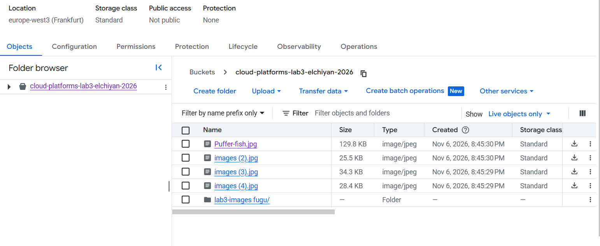
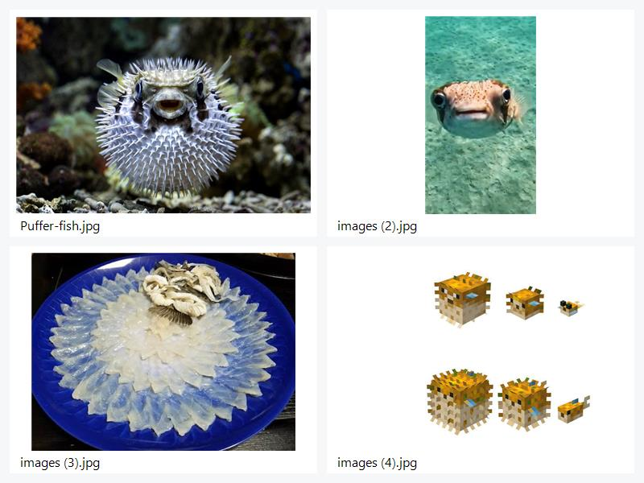
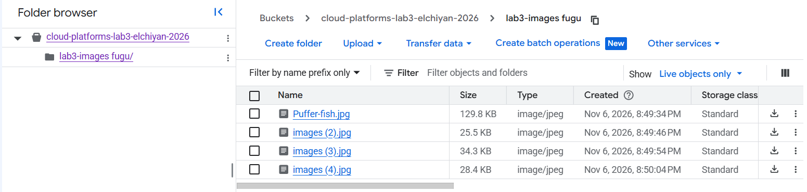
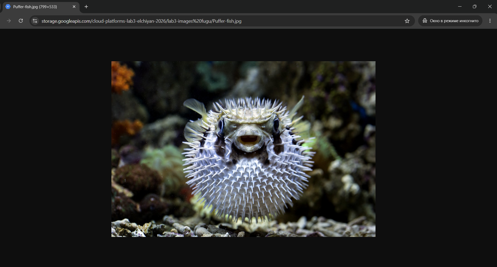
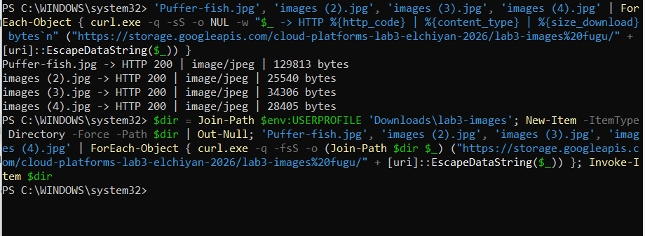
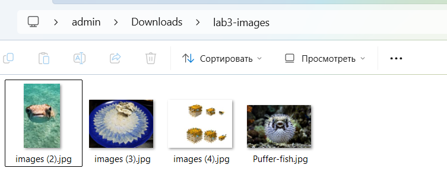

# Лабораторная работа № 3. Исследование Cloud Storage

University: [ITMO University](https://itmo.ru/ru/)\
Faculty: [FICT](https://fict.itmo.ru/)\
Course: [Cloud platforms as the basis of technology entrepreneurship](https://ex-itmo-ict-faculty.github.io/cloud-platforms-as-the-basis-of-technology-entrepreneurship/)\
Year: 2026/2027\
Group: U4225\
Author: Элчиян Роман Романович\
Lab: Lab3\
Date of create: 06.11.2026\
Date of finished: —

## Цель работы

Изучить работу объектного хранилища Google Cloud Storage при создании бакета, размещении объектов и настройке публичного чтения. [Задание лабораторной работы № 3](https://github.com/ex-itmo-ict-faculty/cloud-platforms-as-the-basis-of-technology-entrepreneurship/blob/main/docs/education/labs2023-2024/lab3/lab3.md)

## 1. Создание бакета

В Google Cloud Console в проекте `cloud-platforms-as-the-basis` создан бакет со следующими параметрами.

| Параметр | Значение |
| --- | --- |
| Имя бакета | `cloud-platforms-lab3-elchiyan-2026` |
| Регион | `europe-west3` (Frankfurt) |
| Класс хранения | `Standard` |
| Управление доступом | `Uniform` |

## 2. Загрузка изображений

В корень бакета загружены четыре JPG-файла — `Puffer-fish.jpg`, `images (2).jpg`, `images (3).jpg` и `images (4).jpg`.

*Рисунок 1 — Список объектов в корне бакета после загрузки.*

*Рисунок 2 — Четыре изображения, загруженные в бакет.*

## 3. Создание папки и перемещение файлов

В бакете создана папка `lab3-images fugu`. Все четыре объекта перемещены из корня бакета в эту папку.

*Рисунок 3 — Объекты в папке после перемещения.*

## 4. Настройка публичного доступа

В разделе **Permissions** субъекту `allUsers` назначена роль `Storage Object Viewer` (`roles/storage.objectViewer`) на уровне бакета. В режиме `Uniform` доступ к объектам определяется политикой IAM. Назначенная роль разрешила чтение объектов без входа в Google Cloud.

## 5. Проверка публичных ссылок

Для каждого объекта получен прямой URL Cloud Storage. В адресах пробел в имени папки представлен как `%20`. На рисунке 4 показано открытие файла `Puffer-fish.jpg` в окне инкогнито.

*Рисунок 4 — Проверка публичной ссылки на Puffer-fish.jpg.*

В Windows PowerShell сначала выполнены запросы `GET` к четырём публичным URL через `curl.exe` без передачи учётных данных. Параметр `-o NUL` отбрасывал тело ответа, поэтому файлы на этом этапе не сохранялись. Для каждого запроса получен статус `HTTP 200`, тип `image/jpeg` и ненулевой размер ответа.

*Рисунок 5 — Проверка четырёх ссылок без сохранения файлов и последующая команда скачивания.*

Затем те же URL использованы для скачивания изображений через `curl.exe` в локальную папку `Downloads\lab3-images`. В Проводнике проверено наличие всех четырёх JPG-файлов.

*Рисунок 6 — Изображения, сохранённые на ПК.*

## 6. Удаление бакета

После проверки удалён бакет `cloud-platforms-lab3-elchiyan-2026`.

## 7. Вывод

После настройки публичного доступа были проверены ссылки на все четыре загруженных изображения. Каждый файл успешно открывался в браузере по прямому URL без авторизации в Google Cloud. На рисунке приведён пример проверки файла Puffer-fish.jpg в режиме инкогнито. После завершения проверки созданный бакет был удалён.
