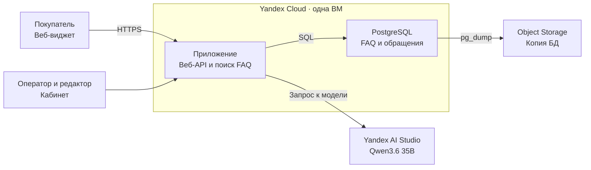
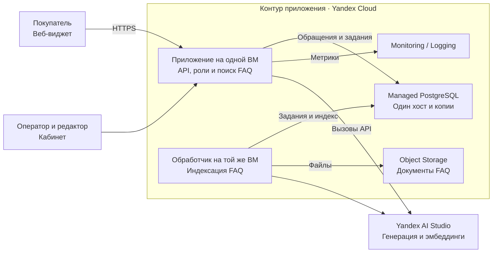
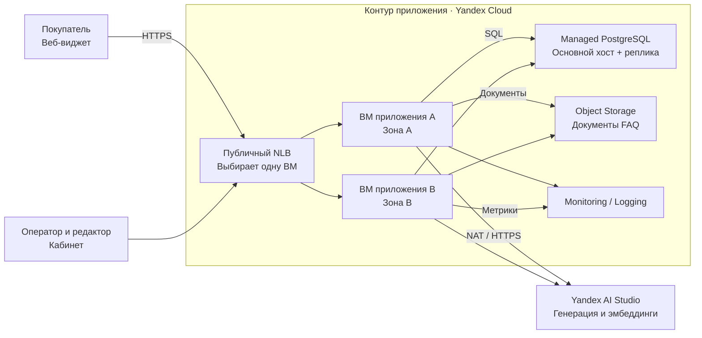
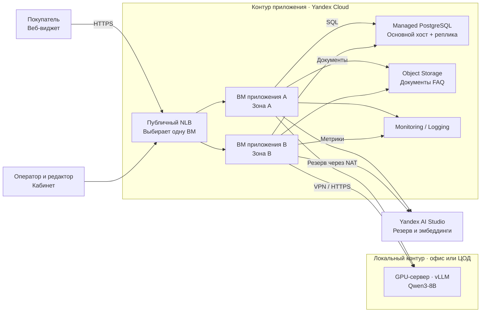

# Лабораторная работа №4. Разработка инфраструктуры MVP AI-приложения

University: [ITMO University](https://itmo.ru/ru/)  
Faculty: [FICT](https://fict.itmo.ru/)  
Course: [Cloud platforms as the basis of technology entrepreneurship](https://github.com/ex-itmo-ict-faculty/cloud-platforms-as-the-basis-of-technology-entrepreneurship)  
Year: 2026/2027  
Group: U4225  
Author: Elchiyan Roman Romanovich  
Lab: Lab4  
Date of create: 05.11.2026\
Date of finished: отчёт подготовлен 09.11.2026

## 1. Продукт и границы работы

**FAQ AI-система** предназначена для служб поддержки малого и среднего бизнеса в Санкт-Петербурге. Она отвечает в веб-виджете по утверждённой базе знаний компании. Если данных недостаточно, система передаёт обращение оператору вместе с темой, кратким контекстом и ссылками на инструкции. Оператор отвечает клиенту и может использовать черновик. Редактор базы знаний — сотрудник компании-партнёра, который проверяет, обновляет и публикует инструкции. В небольшой команде эту роль может выполнять руководитель поддержки.

Проект охватывает текстовые обращения и документы базы знаний. Операции с заказами, платежи, телефония и интеграции с CRM выходят за рамки проекта. В работе спроектированы прототип, пилот и промышленная эксплуатация. Для каждой стадии рассчитаны инфраструктурные расходы. Нагрузка и критерии приёмки заданы как проектные параметры.

## 2. Как обрабатываются вопросы и обновляется база знаний

1. Виджет передаёт вопрос по HTTPS. Сервер определяет компанию по проверенному идентификатору виджета и привязывает к ней сеанс. Для сотрудников компания и роль берутся из серверной сессии.
2. Приложение маскирует телефоны, почту, номера заказов и другие распознаваемые идентификаторы. Поиск сначала ограничивается компанией и опубликованной версией базы знаний. PostgreSQL хранит статьи и их векторы. Полнотекстовый поиск помогает при точных совпадениях, а векторный — при перефразировке. В модель по API уходят вопрос и найденные фрагменты. [Векторный поиск в Managed PostgreSQL](https://yandex.cloud/ru/docs/managed-postgresql/operations/extensions/vector)
3. Сервис проверяет структуру ответа и соответствие ссылок отобранным фрагментам. Порог качества поиска настраивается на размеченных вопросах. Сервис передаёт обращение оператору, если поиск не дал подходящего результата, источники противоречат друг другу, тема требует ручного ответа, клиент просит оператора или истекло время ожидания. Проверка ссылок и редакторская оценка ограничивают ошибки генерации, включая ответы с реальным источником, но неверной интерпретацией.
4. В кабинете оператор получает тему, текст обращения и найденные инструкции. Модель может подготовить выжимку и черновик. При сбое API карточка создаётся по шаблону, а поиск по ключевым словам остаётся доступным. Повторная отправка запроса с тем же ключом не создаёт новый тикет.
5. Редактор загружает текстовую версию документа и подтверждает публикацию после предпросмотра. Индексация разбивает текст на фрагменты и обновляет эмбеддинги. На пилоте и в production загрузка и индексация идут через очередь в PostgreSQL. Для каждой версии документа создаётся одно задание. При сбое обработчик может повторить его. Новая версия становится доступной для поиска после полной индексации. Предыдущая версия доступна для отката.

## 3. Плановая нагрузка

Обращение — один диалог с системой. Принимаем 20 рабочих дней, по 30 обращений в день для прототипа и по 100 от каждой компании на пилоте и в production. Пиковые нагрузки приложения и модели рассчитываются отдельно. Вызовы модели учитывают ответы клиенту, черновики для оператора и повторы.

| Параметр | Прототип | Пилот | Production |
| --- | ---: | ---: | ---: |
| Компаний | 1 демонстрационная | 3 | 20 |
| Обращений в месяц | 600 | 6 000 | 40 000 |
| Пиковая нагрузка приложения, HTTP-запросов/с | 1 | 3 | 12 |
| Пиковая нагрузка модели, вызовов генерации/с | 1 | 1 | 3 |
| Вызовов модели на обращение, клиент / оператор / повтор | 0,75 / 0,15 / 0,05 | 0,80 / 0,25 / 0,05 | 0,85 / 0,25 / 0,05 |
| Вызовов модели в месяц | 570 | 6 600 | 46 000 |
| Средний вход / выход на вызов, токенов | 2 000 / 250 | 2 000 / 250 | 2 000 / 250 |
| Токенов на эмбеддинг запроса, в среднем на обращение | 150 | 150 | 150 |
| Токенов индексации документов в месяц | 200 000 | 1 000 000 | 8 000 000 |
| Средний занятый объём Object Storage, ГБ | 5 | 20 | 100 |
| Входящий + исходящий трафик NLB, ГБ/мес. | — | — | 30 |

Для промышленной эксплуатации принято 2 000 диалогов в рабочий день. В расчётном пике 10% дневного объёма поступают за 10 минут. Это 200 диалогов за 600 с. При шести HTTP-запросах на диалог и коэффициенте кратковременного всплеска 6 приложение получает **12 запросов/с**. Сюда входят сообщения и операции кабинета, например обновление статуса обращения. Для модели используется 1,15 вызова на диалог, поэтому оценка составляет 200 / 600 × 1,15 × 6 ≈ 2,3, или **3 вызова генерации/с** с округлением вверх. Доля диалогов в пике, число HTTP-запросов и коэффициент всплеска — проектные допущения.

При средней длительности генерации 2 с ожидается около шести одновременных вызовов. Базовая квота AI Studio составляет 10 одновременных синхронных генераций. Для экстремального сценария, в котором генерацию вызывают все 12 HTTP-запросов/с, потребуется около 24 одновременных вызовов. До увеличения квоты приложение ограничивает параллельную генерацию. При заполнении очереди обращение передаётся оператору, а фоновая индексация ждёт. [Квоты Yandex AI Studio](https://aistudio.yandex.ru/ru/docs/ai-studio/concepts/limits)

### 3.1. Модели генерации

**В облаке используется Qwen3.6 35B через Yandex AI Studio** с URI `gpt://<folder_id>/qwen3.6-35b-a3b`. Она формирует ответы по найденным фрагментам FAQ и черновики для оператора. Та же модель принимает запросы, которые перенаправляются из локального контура. YandexGPT Lite 5 выводится из эксплуатации 15 ноября 2026 года. Для задач с коротким временем ответа Yandex рекомендует Qwen3.6 35B как замену. [Каталог моделей](https://aistudio.yandex.ru/ru/docs/ai-studio/concepts/generation/models), [прекращение поддержки моделей](https://aistudio.yandex.ru/ru/docs/ai-studio/release-notes/deprecations)

Пригодность к FAQ оценивается по вопросам из утверждённой базы и по случаям, где подходящего ответа в базе нет. Проверяются точность по источнику, корректность отказа, доля передачи оператору и задержка полного ответа. Ссылки проверяются по списку фрагментов, а корректность смысла оценивается на размеченной выборке. Автоответы включаются только для прошедших проверку тем.

Примеры из России показывают несколько подходов. «Инфосистемы Джет» применяли YandexGPT для классификации и ответов в сервисном центре. В кейсе Ralf Ringer YandexGPT Lite использовалась для классификации, а контекстный ответ формировала YandexGPT 3. СберМобайл сообщил о виртуальных консультантах поддержки на базе GigaChat. [Инфосистемы Джет](https://yandex.cloud/ru/cases/jet), [Ralf Ringer](https://yandex.cloud/ru/cases/ralf), [СберМобайл](https://sbermobile.ru/about/news/sbermobajl-zapustil-set-ii-agentov-dlya-podderzhki-klientov.html)

## 4. Три состояния инфраструктуры

В расчёте выбран Yandex Cloud, регион Россия. Модель вызывается по API, а приложение, PostgreSQL и хранилище находятся в облаке. [Исходники схем Draw.io](diagrams/faq-ai.drawio)

### 4.1. Прототип

[SVG](diagrams/mvp.svg)

В прототипе одна ВМ с Linux, 2 vCPU, 4 ГБ памяти и SSD на 40 ГБ. На ней работают приложение и PostgreSQL с индексом FAQ, версиями статей и очередью обращений. TLS завершается на ВМ. В демонстрационном сценарии используются тестовые данные. Один раз в сутки PostgreSQL экспортируется в закрытый бакет. Прямой публичный доступ к PostgreSQL закрыт. Если VM недоступна, на сайте партнёра остаётся статическая ссылка на его поддержку, независимая от сервиса.

### 4.2. Пилот у партнёров

[SVG](diagrams/pilot.svg)

Приложение работает на одной ВМ с 2 vCPU, 4 ГБ памяти и SSD на 30 ГБ. PostgreSQL выделен в управляемый кластер с одним приватным хостом 2 vCPU / 8 ГБ / 40 ГБ SSD. База хранит обращения, индекс и задания индексации. Исходные документы и их версии лежат в закрытом Object Storage. Раздельный доступ обеспечивается проверкой роли, ограничением по компании в приложении и политиками RLS в PostgreSQL. Для каждого запроса контекст компании выставляется внутри транзакции. Роль приложения подчиняется RLS и не владеет таблицами. В Monitoring и Logging поступают задержки, ошибки, число токенов и агрегаты качества без текста обращений.

Автоматические копии PostgreSQL хранятся семь суток. План пилота предусматривает пробное восстановление в отдельный кластер. Для Object Storage включается версионирование и задаётся срок хранения старых версий. Приложение и БД остаются одиночными точками отказа на этой стадии. [Резервные копии Managed PostgreSQL](https://yandex.cloud/ru/docs/managed-postgresql/concepts/backup)

### 4.3. Промышленная эксплуатация с моделью по API

[SVG](diagrams/production.svg)

Публичный Network Load Balancer принимает соединения на TCP 443. Для каждого TCP-соединения NLB выбирает **одну** доступную ВМ приложения. A и B — одинаковые экземпляры приложения в разных зонах, которые одновременно принимают разные соединения. TLS завершается на выбранной ВМ. Она выполняет поиск, проверяет контекст и при необходимости отправляет запрос модели. Если проверка доступности ВМ завершается ошибкой, новые соединения идут на другую ВМ. При повторной отправке обращения ключ идемпотентности предотвращает создание дубликата.

Реплики приложения работают с общей PostgreSQL и Object Storage. База состоит из двух приватных хостов по 2 vCPU, 8 ГБ памяти и 40 ГБ SSD. Запись идёт на основной хост. При его отказе роль переходит к реплике, а приложение восстанавливает соединение. Доступ к AI Studio идёт через управляемый NAT-шлюз. [Особенности реализации NLB](https://yandex.cloud/ru/docs/network-load-balancer/concepts/specifics), [проверки доступности](https://yandex.cloud/ru/docs/network-load-balancer/concepts/health-check), [репликация PostgreSQL](https://yandex.cloud/ru/docs/managed-postgresql/concepts/replication)

Одна реплика приложения должна выдерживать согласованный пик в режиме деградации. Масштабирование предусматривает группу ВМ с минимумом 2 и максимумом 4 экземпляра. Добавление ресурсов запускается по устойчивому росту загрузки или вручную по уведомлению о росте очереди или задержки. В смету входят две постоянно работающие ВМ. При добавлении двух ВМ на 120 часов вычисления и их диски добавят около 1 055 ₽. Обновление приложения выполняется поочерёдно, с проверкой готовности и откатом версии при ошибке. Секреты отделены от репозитория. Доступ сервисных аккаунтов ограничен необходимыми операциями.

| Событие | Реакция | Проектная цель проверки |
| --- | --- | --- |
| AI API недоступен или превышена квота | Готовые FAQ по ключевым словам, передача оператору с шаблонной карточкой. Генерация отключается по ошибкам и тайм-аутам | Тикет создаётся один раз, есть канал ручного ответа |
| Одна реплика приложения недоступна | NLB направляет трафик на доступную реплику, очередь продолжает обрабатываться | Оставшаяся реплика выдерживает пиковую нагрузку. NLB исключает сбойный узел за 60 с |
| Недоступен основной хост PostgreSQL | Управляемое переключение, переподключение приложения к новому основному хосту | RTO ≤ 15 минут, RPO ≤ 5 минут в тесте отказа хоста |
| Ошибочное удаление или порча БД | Восстановление в новый кластер, проверка выборки и переключение приложения | RTO ≤ 4 ч, RPO ≤ 1 ч для БД при доступных резервных копиях |
| Недоступен регион | Статическая ссылка на канал партнёра | Отдельная региональная репликация отсутствует в проекте |

RTO — время до восстановления обслуживания. RPO — максимально допустимая потеря изменений по времени. Для MVP целевой RPO по данным — сутки по ежедневной копии. Для пилота план восстановления — до 8 часов, допустимая потеря данных — до 24 часов. Для документов сроки сверяются отдельно при тесте восстановления версий. Цели сформулированы для тестов и зависят от фактического состояния копий и сети.

### 4.4. Промышленная эксплуатация с собственным GPU

[SVG](diagrams/production-gpu.svg)

Приложение, PostgreSQL и хранилище остаются в Yandex Cloud. Генерацию можно перенести на отдельный сервер с vLLM и моделью Qwen3-8B. Рассмотрены два варианта размещения — сервер 2U с NVIDIA L4 в ЦОД Санкт-Петербурга и офисная станция с RTX 5090. Сравнение расходов приведено в разделах 6.1 и 9. [Qwen3-8B](https://huggingface.co/Qwen/Qwen3-8B), [vLLM](https://docs.vllm.ai/en/latest/serving/openai_compatible_server/)

Обе реплики приложения обращаются к локальной модели по HTTPS внутри VPN. При отказе GPU, превышении допустимой очереди или тайм-ауте генерацию выполняет Qwen3.6 35B через AI Studio. Поиск, проверка ссылок и передача оператору остаются в приложении. Эмбеддинги в обеих конфигурациях рассчитывает AI Studio. Резервный вызов выполняется последовательно после отказа локальной модели или при пропуске занятой очереди. Если обе модели недоступны, сохраняются поиск по FAQ и ручная обработка.

## 5. Данные, безопасность и критерии пилота

### 5.1. Требования к защите персональных данных

Прототип использует синтетические данные. Пилот и промышленная эксплуатация могут получать имена, контакты и номера заказов. Сфера проекта — обычная поддержка малого и среднего бизнеса. Обработка специальных категорий данных и биометрии в проект не входит. Состав мер определяется после инвентаризации данных и модели угроз. Для информационной системы персональных данных уровень защищённости определяется по постановлению № 1119, а меры подбираются по приказу ФСТЭК № 21. [152-ФЗ, ст. 18–19](https://pravo.gov.ru/proxy/ips/?docbody=&nd=102108261), [постановление № 1119](https://35.rosstat.gov.ru/storage/mediabank/%D0%A2%D0%A0%D0%95%D0%91%D0%9E%D0%92%D0%90%D0%9D%D0%98%D0%AF%2B%D0%BA%2B%D0%B7%D0%B0%D1%89%D0%B8%D1%82%D0%B5%2B%D0%BF%D0%B5%D1%80%D1%81%2B%D0%B4%D0%B0%D0%BD-%D0%9F%D0%9E%D0%A1%D0%A2%D0%90%D0%9D%D0%9E%D0%92%D0%9B%D0%95%D0%9D%D0%98%D0%95%282%29.pdf), [приказ ФСТЭК № 21](https://minjust.consultant.ru/documents/6146?items=10)

| Область | Что предусмотрено |
| --- | --- |
| Правовые основания и роли | Партнёр определяет цели и основания обработки клиентских обращений. Если поставщик FAQ-сервиса обрабатывает данные по поручению партнёра, договор фиксирует данные, операции, цели и меры защиты. Для собственных целей обработки роли определяются отдельно. До начала обработки оператор проверяет обязанность уведомить Роскомнадзор по ст. 22. На странице сбора данных размещается политика обработки. |
| Локализация и передача | При сборе данных граждан РФ применяются требования локализации по ч. 5 ст. 18. Базы обращений, резервные копии и журналы размещаются в России. В облачную и локальную модели передаются только необходимые фрагменты утверждённой базы и очищенный текст. При обнаружении чувствительных данных запрос передаётся оператору. Маскирование дополняет меры защиты и само по себе не подтверждает обезличивание. Условия обработки, хранения и удаления у облачного поставщика проверяются для выбранного сервиса и региона. |
| Доступ и сеть | Отдельные роли оператора, редактора базы знаний и администратора, MFA для сотрудников, разграничение по компании, приватная БД и хранилище. Секреты в Lockbox, TLS на внешних и внутренних соединениях, VPN для собственного GPU. Для локальной станции предусмотрены шифрование диска, ограничение физического доступа и обновления. |
| Журналы, восстановление, удаление | События доступа, изменения ролей, выгрузка и удаление фиксируются без текста обращений. Резервные копии доступны отдельной роли. Проверяются восстановление и удаление по сроку хранения. При инциденте, подпадающем под ч. 3.1 ст. 21, оператор уведомляет Роскомнадзор в течение 24 ч и передаёт результаты внутреннего расследования в течение 72 ч. |
| Проверка перед пилотом | Модель угроз, утверждённый перечень мер, проверка изоляции между компаниями, проверка восстановления и фиксация результатов оценки эффективности защиты. Требования к сертифицированным средствам и оценке соответствия зависят от уровня защищённости и применимых отраслевых норм. |

Провайдер отвечает за свою часть инфраструктуры. Проект приложения, доступы, сроки хранения и реагирование остаются в зоне ответственности сторон по договору. Для расчёта расходы на меры защиты показаны отдельно от базового облачного бюджета. [Облако для персональных данных](https://yandex.cloud/ru/solutions/152-fz), [Lockbox](https://yandex.cloud/ru/docs/lockbox/pricing), [Audit Trails](https://yandex.cloud/ru/docs/audit-trails/pricing)

### 5.2. Меры в приложении и план пилота

- **Доступ и хранение.** База и бакеты закрыты. Объекты хранятся по префиксам компаний, выдача файлов идёт через проверку прав в приложении. Тесты изоляции охватывают поиск, прямой запрос чужого объекта, выгрузку и фоновые задания. Оператор читает обращения, редактор публикует статьи, администратор назначает роли. Изменения ролей, статуса тикета и опубликованной версии фиксируются в аудите.
- **Минимизация данных.** В AI API передаются только отобранные фрагменты утверждённой базы и очищенный текст. Правила маскирования дополняются проверкой тестовых сообщений и запрещёнными категориями данных. Нераспознанные персональные данные остаются риском, который проверяется на пилоте до включения реальных данных. Проектный срок хранения обращений — 30 дней, технических журналов — 14 дней, резервных копий PostgreSQL — 7 дней на пилоте и 14 дней в production. Сроки уточняются по договору. Для удаления учитываются копии и версии, а после восстановления повторно применяется журнал удалений.
- **Порядок пилота.** Сначала отбираются типовые и сложные вопросы по каждой компании. Сотрудники размечают ожидаемые ответы, источники и случаи передачи оператору. После проверки на закрытом наборе приложение работает в кабинете оператора. Затем включаются автоматические ответы на ограниченные темы. Для сравнения используются схожие темы и смены с ассистентом и без него. До начала пилота определяют объём выборки, окно для учёта повторных обращений и критерии оценки.
- **Критерии перехода в production.** Предлагаемый минимум — 200 размеченных случаев по трём партнёрам, включая вопросы без ответа и межклиентские проверки доступа. Не менее 90% корректных ответов с опорой на источник среди проверенных автоответов, ноль критических ошибок в выборке и ноль найденных межклиентских утечек. P95 времени до ответа или передачи — до 6 с на согласованном профиле нагрузки. В плане пилота предусмотрено измерение доли повторных обращений по той же теме за 48 часов, время активной работы оператора, время передачи и доля черновиков, принятых без существенной правки. Результаты разбиваются по темам и партнёрам. Отдельно проверяются восстановление из копии и работа при отключении AI API.

## 6. Ежемесячные расходы на инфраструктуру

Смета на 30 дней (720 ч), рубли с НДС, расчёт на 09.11.2026. Использованы опубликованные ставки Yandex Cloud и оценочный резерв. Размеры, срок работы, объёмы и лимиты задаются на каждую стадию. Цены сверяются в калькуляторе перед фактическим запуском.

| Ресурс | Формула или ставка | Прототип | Пилот | Production |
| --- | --- | ---: | ---: | ---: |
| Compute Cloud, Linux VM | Число VM × 720 × (2 × 1,24 + 4 × 0,33) | 2 736,00 | 2 736,00 | 5 472,00 |
| SSD приложения | Число VM × 720 × размер диска × 0,0199 | 573,12 | 429,84 | 859,68 |
| Managed PostgreSQL, хосты s3-c2-m8 | Число хостов × 720 × (2 × 1,8792 + 8 × 0,5072) | — | 5 627,52 | 11 255,04 |
| SSD PostgreSQL | Число хостов × 720 × 40 × 0,0198 | — | 570,24 | 1 140,48 |
| Object Storage Standard | (Средний объём − 1 ГБ) × 2,376 | 9,50 | 45,14 | 235,22 |
| Публичный IP приложения | 720 × 0,26352, где VM принимает трафик напрямую | 189,73 | 189,73 | — |
| Публичный NLB | 720 × 0,8564 + 30 ГБ × 0,0659 | — | — | 618,59 |
| NAT-шлюз | 720 × 0,39528 | — | — | 284,60 |
| Qwen3.6 35B, синхронный API | Вызовы × (2 × 0,20 + 0,25 × 0,30) | 270,75 | 3 135,00 | 21 850,00 |
| Эмбеддинги | (Токены запросов + индексации) / 1 000 × 0,0101 | 2,93 | 19,19 | 141,40 |
| **Итого по тарифам** | Округление после сложения | **3 782,04** | **12 752,67** | **41 857,01** |
| Резерв на домен, служебные операции и наблюдаемость | Проектная оценка, фактический расход проверяется | 150,00 | 300,00 | 600,00 |
| **Базовый бюджет в месяц** | **Тарифы + резерв** | **3 932,04** | **13 052,67** | **42 457,01** |

Источники ставок и правил расчёта — [Compute Cloud](https://yandex.cloud/ru/docs/compute/pricing), [Managed PostgreSQL](https://yandex.cloud/ru/docs/managed-postgresql/pricing), [Object Storage](https://yandex.cloud/ru/docs/storage/pricing), [VPC](https://yandex.cloud/ru/docs/vpc/pricing), [NLB](https://yandex.cloud/ru/docs/network-load-balancer/pricing), [прайс-лист для РФ со ставками NLB и диска БД](https://storage.yandexcloud.net/cloud-www-assets/blog-assets/ru/posts/2025/11/vat-changes-ru-2025/%D0%A2%D0%B0%D1%80%D0%B8%D1%84%D1%8B_Yandex_%D0%A1loud_RU.pdf), [AI Studio](https://aistudio.yandex.ru/ru/docs/ai-studio/pricing).

**Границы сметы.** В базовом сценарии операции Object Storage и исходящий интернет-трафик укладываются в бесплатные объёмы. Трафик самого NLB рассчитан отдельно. Для резервных копий Managed PostgreSQL принято, что их суммарный объём не превышает ёмкости дисков кластера (40 ГБ на пилоте и 80 ГБ в production), а экспорт MVP уже включён в объём бакета. Стоимость тестового кластера на время восстановления, превышение квот хранения, CRM-лицензии, платный облачный саппорт и труд команды учитываются отдельно при необходимости. Резерв на наблюдаемость уточняется по объёму записи, хранения и чтения метрик и логов. [Monitoring](https://yandex.cloud/ru/docs/monitoring/pricing), [Cloud Logging](https://yandex.cloud/ru/docs/logging/pricing)

**Чувствительность.** При той же инфраструктуре и увеличении числа диалогов с 40 000 до 80 000 в месяц расходы на генерацию увеличатся на 21 850 ₽, а на эмбеддинги вопросов — ещё на 60,60 ₽. При неизменных объёмах документов и при условии, что два экземпляра выдерживают пик, ориентир составит около 64,4 тыс. ₽/мес. Увеличение среднего входа на 1 000 токенов при 46 000 вызовов добавит 9 200 ₽/мес. Значит, перед запуском важно измерить длину контекста и вызовы по каждому сценарию, включая повторные запросы и работу оператора.

### 6.1. Сравнение с сервером 2U в ЦОД

Подход взят из лекции «Обзор Cloud платформ» и работы Fisher. Сравниваем накопленные расходы от месяца покупки до конца 12-го месяца. Один год принят как целевой срок окупаемости. При одинаковой нагрузке базовая конфигурация приложения, БД, хранилища и векторизации принята одинаковой. В гибриде дополнительно учитываются передача запросов в локальный контур, VPN, журналы, защита и обслуживание GPU. Например, 200 000 локальных вызовов при 20 КБ суммарного обмена на вызов дают около 4 ГБ трафика в месяц до накладных расходов VPN. Увеличение объёмов логов, изменение модели эмбеддингов или перенос БД потребуют пересчёта общих статей. Срок из примера лекции относится к её исходным данным. [Fisher, 2018, рис. 2](https://www.scirp.org/journal/paperinformation?paperid=87661#f2)

Тарифы проверены 9 ноября 2026 года. Синхронный Qwen3.6 35B стоит 0,20 ₽ за 1 000 входных токенов и 0,30 ₽ за 1 000 выходных токенов с НДС. Вызов на 2 000 входных и 250 выходных токенов стоит 0,475 ₽ без учёта кеширования и инструментов. Расчёт предполагает выключенный режим рассуждений. При 46 000 вызовов в месяц генерация стоит 21 850 ₽, а эмбеддинги остаются в обеих сметах по 0,0101 ₽ за 1 000 токенов. Если локальная модель заменяет 80% стоимости генерации, резервный API стоит 4 370 ₽/мес., а экономия на внешней генерации составляет 17 480 ₽/мес. Доля 80% — сценарий, который включает обращения, ушедшие на резерв. [Тарифы Yandex AI Studio](https://aistudio.yandex.ru/ru/docs/ai-studio/pricing)

| Статья собственного контура | Разово | В месяц | Основание |
| --- | ---: | ---: | --- |
| NVIDIA L4 24 ГБ | 507 194 ₽ | — | Карта в наличии, гарантия 12 месяцев, с НДС. Другой поставщик публикует 469 125 ₽, НДС в цене не уточнён. ServerPoint указывает 697 200 ₽ с НДС за восстановленную карту, поэтому это отдельное предложение. [Сервер Центр](https://server-center.ru/products/graficeskii-uskoritel-nvidia-l4-24gb-gddr6-900-2g193-0000-001), [Юникомп](https://unicomps.ru/product/modul-vychislitelnyy-nvidia-l4-24gb-pcie-900-2g193-0000-000/), [ServerPoint](https://serverpoint.ru/products/nvidia-l4-24gb-72w-pci-e-passive-65435/) |
| Сервер Dell PowerEdge R760xa, 2U | 1 450 000 ₽ | — | Опубликованная цена «от» за базовую конфигурацию. Dell подтверждает поддержку L4. Цена сборки с GPU-комплектом, фактическая комплектация и НДС требуют подтверждения поставщиком. [Serverline](https://serverline.tech/catalog/good?alias=poweredge-760xa&id=166), [Dell](https://www.dell.com/en-us/infohub/articles/poweredge-xs-vs-standard-vs-xa-vs-xd2) |
| Размещение и сеть | — | 10 858 ₽ | Публичный тариф ФИЛАНКО для 2U, до 550 Вт по БП, один IP и порт 100 Мбит/с. КОМПЛИТ публикует 10 900 ₽ с НДС для 2U, 100 Мбит/с и IPv4. Допустимая мощность на его странице не указана. [ФИЛАНКО](https://datahouse.spb.ru/arenda-unitov/), [КОМПЛИТ](https://www.dc-complete.ru/colocation) |
| Дополнительный лимит питания | — | 32 330 ₽ | Сценарий тарификации по номиналу одного БП 2 400 Вт. Сверх 550 Вт считаем 1,9 кВт после округления, то есть 15 860 ₽ за 1 кВт и 9 × 1 830 ₽ за 100 Вт. Расчёт предполагает суммирование пакетов. Условия тарификации резервного БП определяются договором с ЦОД. [Спецификация Dell](https://www.dell.com/support/manuals/en-si/oth-r760xa/r760xa_ism_pub/psu-specifications?guid=guid-2ebf92fd-db27-464f-b853-d8b7b93e8ec1&lang=en-us), [Тарифы ФИЛАНКО](https://datahouse.spb.ru/arenda-unitov/) |
| Настройка vLLM, VPN и мониторинга | 17 550 ₽ | — | Допущение 16 ч × 1 096,88 ₽/ч. Ставка оценена по открытой вилке Linux/DevOps 120–150 тыс. ₽ до НДФЛ, с 30% взносов и 160 ч/мес. [Выдача hh.ru](https://spb.hh.ru/vacancies/sistemnyj-administrator-linux-devops), [ФНС](https://www.nalog.gov.ru/rn77/taxation/insprem/) |
| Обновления и обслуживание | — | 4 387,50 ₽ | Допущение 4 ч/мес. по той же ставке. VPN использует существующие ВМ и NAT в облаке, без отдельного платного шлюза в модели. |
| Доставка, монтаж, кабели | 10 000 ₽ | — | Резерв до получения цены. |
| Ремонт и работы на площадке | — | 3 631 ₽ | Проектный резерв 1 631 ₽/мес. на ремонт (1% цены сервера и GPU в год) и 2 000 ₽/мес. на работы ЦОД. |
| Дополнительная защита локального контура | 8 775 ₽ | 2 193,75 ₽ | Изоляция, шифрование и проверка доступа. Расчёт приведён в разделе 6.3. |
| **Итого по собственному контуру** | **1 993 519 ₽** | **53 400,25 ₽** | Включает опубликованные цены и отдельно указанные проектные допущения. |

*Накопленные расходы за 12 месяцев. Общие для обеих конфигураций расходы на защиту из раздела 6.3 вынесены отдельно. Базовая нагрузка постоянна. Пунктир показывает только карту и базовое размещение 1U, даже без покупки сервера. Остаточную стоимость, изменение тарифов, инфляцию и дисконтирование принимаем равными нулю в учебном расчёте.*

| Сценарий | В месяц после покупки | За 12 месяцев |
| --- | ---: | ---: |
| Production через API | 42 457,01 ₽ | **509 484 ₽** |
| Гибрид, карта и минимальное размещение, без стоимости сервера и обслуживания | 32 175,01 ₽ | **893 294 ₽** |
| Гибрид, пример с сервером 2U и эксплуатацией | 78 377,26 ₽ | **2 934 046 ₽** |

При плановых 40 000 диалогов/мес. собственный контур с указанным сервером не окупается. Его ежемесячные расходы 53 400,25 ₽ уже выше экономии на API в 17 480 ₽, даже до покупки оборудования. Даже урезанный сценарий с картой и размещением дороже API по итогам года.

Порог окупаемости за год считается как `разовые затраты / 12 + ежемесячные расходы собственного контура`. Для указанного сервера нужно ежемесячно замещать генерацию на **219 527 ₽**. Если ЦОД согласует тот же тариф без доплаты за питание, порог снизится до **187 197 ₽/мес.** Сравниваем эти значения с суммой, которую GPU реально снимает со счёта за API.

### 6.2. Производительность локальной модели

Расчётный пик модели — 3 вызова/с. При маршрутизации 80% пиковых вызовов на GPU и среднем ответе в 250 токенов локальному контуру потребуется 600 выходных токенов/с. Для оценки использованы опубликованные прогоны Qwen3-8B. Длина запросов и режимы нагрузки в этих прогонах различаются.

| Ускоритель | Опубликованный результат | Карт по суммарной пропускной способности |
| --- | --- | ---: |
| NVIDIA L4, vLLM | 228 выходных токенов/с при подаче 2 запросов/с и профиле 512/128. [Результаты](https://aiengineeringfromscratch.com/manual-vllm-101/ref-lab-notes#l4-rate-requests-each-second-512-prompt-and-128-output-tokens) | 3 |
| NVIDIA H100, vLLM | 2 726 выходных токенов/с без спекулятивного декодирования, 7 317 с EAGLE3. Ограничение параллельности 32. [Результаты](https://gist.github.com/jiangLLM/e95756b974f385846e4277b7ee68d6c8) | 1 |
| NVIDIA B200, vLLM | 7 379–9 599 выходных токенов/с при 64 параллельных запросах и профиле 1 024/256. [Результаты](https://www.reddit.com/r/FunMachineLearning/comments/1wplneg/qwen38b_on_a_single_b200_from_240_to_11000_toks/) | 1 |
| NVIDIA RTX 5090, Qwen3-8B NVFP4 | 411 выходных токенов/с в RAG-тесте с контекстом 8K и восемью параллельными запросами. [Результаты](https://arxiv.org/html/2601.09527v1#A1) | 2 |

Число карт в таблице характеризует только сценарий переноса большей части **пика** на локальную генерацию. В экономической модели офисная станция обрабатывает часть **месячного** объёма. Пики принимает API. Показатели тестов используются для оценки пропускной способности, а P95 полного ответа до 6 с остаётся проектной целью.

**Qwen3.5-9B** рассматривается как кандидат для локальной генерации. У модели открытые веса, и в её официальной карточке описан запуск через vLLM. В опубликованном прогоне Qwen3.5-9B BF16 на RTX 5090 при 16 параллельных запросах P95 полного ответа составила 7,48 с. В тесте использован ShareGPT. Для сметы сохранён **Qwen3-8B NVFP4**, поскольку для этой конфигурации есть отдельный RAG-тест на той же карте. Опубликованные прогоны различаются по данным, квантизации и нагрузке, поэтому выбор качества по ним сделать нельзя. [Карточка Qwen3.5-9B](https://huggingface.co/Qwen/Qwen3.5-9B), [замер Qwen3.5-9B](https://github.com/hexgrid-cloud/open-llm-benchmarks/blob/main/results/rtx5090-qwen3.5-9b-bf16-vllm.md), [RAG-тест Qwen3-8B](https://arxiv.org/html/2601.09527v1#A1)

### 6.3. Расходы на защиту данных

Ниже приведена проектная оценка для пилота и промышленной эксплуатации. Она добавляется к базовому бюджету раздела 6. Для прототипа с синтетическими данными этих дополнительных расходов в модели нет.

| Статья | Расчёт | Стоимость |
| --- | --- | ---: |
| Документы, договорные условия и уведомления | 12 ч × 2 500 ₽/ч | 30 000 ₽ разово |
| Модель угроз и оценка защиты | 40 ч × 1 096,875 ₽/ч. Определение уровня защищённости, проверка мер, протокол оценки эффективности | 43 875 ₽ разово |
| Текущая защита на пилоте | 2 ч/мес. инженера и 500 ₽/мес. на секреты, доставку событий и хранение журналов | 2 694 ₽/мес. |
| Текущая защита в промышленной эксплуатации | 4 ч/мес. инженера и 1 500 ₽/мес. на те же сервисы и хранение журналов | 5 888 ₽/мес. |
| Дополнительные меры для собственного GPU | 8 ч разово на изоляцию, шифрование и проверку доступа, затем 2 ч/мес. на проверку локального контура | 8 775 ₽ разово и 2 194 ₽/мес. |

Итого базовый бюджет с защитой составляет **15 746 ₽/мес. для пилота** и **48 345 ₽/мес. для облачной промышленной эксплуатации**. Подготовка к работе с реальными данными — **73 875 ₽ разово**. Часы, ставка специалиста по документам и расходы на журналы заданы для сметы. Бюджеты внешней оценки, лицензий на специальные средства защиты и дополнительных отраслевых требований рассчитываются после определения применимых мер. Они зависят от контура и договора. [Тарифы Lockbox](https://yandex.cloud/ru/docs/lockbox/pricing), [тарифы Audit Trails](https://yandex.cloud/ru/docs/audit-trails/pricing)

## 7. Внедрение и эффект для службы поддержки

### 7.1. Разовые работы

| Работа | Кто выполняет | Часы для планирования |
| --- | --- | ---: |
| Виджет, API, кабинет и очередь обращений | Backend / full-stack | 80 |
| Поиск, маскирование, промпты и тесты ответов | AI / backend | 48 |
| Настройка окружений, CI/CD, копий, метрик и проверки восстановления | DevOps | 40 |
| Проверка ролей, интеграционные и нагрузочные тесты | QA | 32 |
| Подготовка статей, разметка вопросов, обучение операторов | Редактор базы знаний и представитель партнёра | 24 |
| **Всего** | | **224** |

Оценка разового бюджета — сумма часов по ролям, умноженных на полную часовую ставку каждой роли. Например, изменение средней ставки на 1 000 ₽/ч сдвигает бюджет на 224 000 ₽. Подключение каждого нового партнёра после пилота считается отдельно по часам настройки, импорта базы и обучения. Ежемесячное сопровождение рассчитывается отдельно по часам дежурного, инженера и редактора и стоимости лицензий. Часы на защиту данных уже учтены в разделе 6.3.

### 7.2. Оценка часа оператора в Санкт-Петербурге

Проверены выдачи hh.ru за 9 ноября 2026 года в двух порядках. Параметры — Санкт-Петербург, полная занятость, указан доход и поиск «чат поддержка». В расчёт вошли прямые карточки с двумя границами месячной вилки и письменной либо смешанной поддержкой. Исключены дубли, частичная занятость, руководители, продажи и вакансии с доплатой за подключение услуг. Сортировка помогает найти кандидатов на обоих концах диапазона. Роль и условия работы проверяются по карточке. [По возрастанию](https://spb.hh.ru/search/vacancy?area=2&only_with_salary=true&employment=full&order_by=salary_asc&text=%D1%87%D0%B0%D1%82%20%D0%BF%D0%BE%D0%B4%D0%B4%D0%B5%D1%80%D0%B6%D0%BA%D0%B0), [по убыванию](https://spb.hh.ru/search/vacancy?area=2&only_with_salary=true&employment=full&order_by=salary_desc&text=%D1%87%D0%B0%D1%82%20%D0%BF%D0%BE%D0%B4%D0%B4%D0%B5%D1%80%D0%B6%D0%BA%D0%B0)

| Вакансия | Дата | Вилка, ₽/мес. | Середина до НДФЛ, ₽/мес. |
| --- | --- | ---: | ---: |
| [РИВ ГОШ, чат-поддержка](https://spb.hh.ru/vacancy/138116856) | 08.11.2026 | 42 000–57 000 на руки | 56 897 |
| [Система Геткурс, клиентская поддержка](https://spb.hh.ru/vacancy/134448870) | 07.11.2026 | 52 000–62 900 до НДФЛ | 57 450 |
| [МК Групп, поддержка пользователей](https://spb.hh.ru/vacancy/138983124) | 07.11.2026 | 45 000–60 000 на руки | 60 345 |
| [Финансовый Кластер, письменная поддержка](https://spb.hh.ru/vacancy/138983196) | 06.11.2026 | 70 000–77 000 на руки | 84 483 |
| [Трофимова, чаты и звонки](https://spb.hh.ru/vacancy/139039555) | 07.11.2026 | 61 000–95 000 на руки | 89 655 |
| **Медиана пяти середин** | | | **60 345** |

Для сумм «на руки» применён пересчёт делением на 0,87 при НДФЛ 13%. При общей ставке взносов 30% и 160 оплачиваемых часах в месяц получаем ориентир **490 ₽/ч**. Доплаты и тариф травматизма считаются отдельно. Это медиана отобранных объявлений. [НДФЛ и страховые взносы ФНС](https://www.nalog.gov.ru/html/sites/www.rn77.nalog.ru/2025/2kv2025/presentacii/IPSYSTEM.pdf), [тарифы взносов ФНС](https://www.nalog.gov.ru/rn77/taxation/insprem/)

### 7.3. Высвобождаемое время и денежный эффект

В расчётном примере одна компания получает 3 200 обращений в месяц. Доли обращений, минуты и часы редактора в таблице — сценарные допущения. В группу самообслуживания входят случаи, где запрос решён без оператора и без повтора по теме в течение 48 часов. В группу помощи входят только обращения, завершённые оператором с подсказками. Время по базе знаний — отдельные часы редактора за вычетом дополнительной модерации. Ускорение подготовки ответа уже содержит поиск, чтение краткого резюме, проверку и правку, поэтому эти минуты отдельно не складываются.

| Сценарий | Самообслуживание, доля всех / мин. на обращение | Помощь оператору, доля всех / сэкономлено мин. | Часы операторов | Часы редактора | Оценка времени операторов |
| --- | --- | --- | ---: | ---: | ---: |
| Нижний | 15% / 4 | 25% / 1 | 45,3 | 1 | 22,2 тыс. ₽ |
| Базовый | 30% / 4,5 | 40% / 1,8 | 110,4 | 3 | 54,1 тыс. ₽ |
| Верхний | 45% / 5 | 40% / 2,5 | 173,3 | 5 | 85,0 тыс. ₽ |

Формула для оператора — обращения × (доля самообслуживания × минуты ручной обработки + доля помощи × разница времени ручной и ассистированной обработки) / 60. Для базового примера это 72 часа на самообслуживании и 38,4 часа на помощи оператору. Редакторские часы оставлены отдельно до уточнения ставки. В план пилота входят проверка времени до первого ответа, качества передачи оператору, повторных обращений и того, помогает ли классификация находить пробелы в базе знаний.

Сумма в таблице отражает ценность высвобожденного времени. Денежный эффект клиента рассчитывается по подтверждённому сокращению оплачиваемых сверхурочных, подрядных часов или потребности в найме за вычетом цены сервиса и расходов на сопровождение со стороны клиента. Срок окупаемости клиента — его разовые затраты, делённые на положительный чистый денежный эффект в месяц. Для поставщика сервиса считается своя экономика — выручка от компаний за вычетом общей облачной сметы и расходов команды. Без цены сервиса, ставок и результатов пилота срок окупаемости не определён.

## 8. Источники и допущения для расчёта

| Параметр | Откуда берётся | На что влияет |
| --- | --- | --- |
| ВМ, SSD, PostgreSQL, сеть и хранение | Размеры и тарифы указаны в смете. Для контрольного расчёта подходит [калькулятор Yandex Cloud](https://yandex.cloud/ru/prices) | Базовая стоимость инфраструктуры, хранения и трафика |
| Цена модели и эмбеддингов | [Тарифы AI Studio](https://aistudio.yandex.ru/ru/docs/ai-studio/pricing). Число вызовов и длина контекста заданы в разделе 3 | Стоимость обращения и рост расходов при увеличении нагрузки |
| Стоимость часа оператора | Ориентир по пяти прямым карточкам. Для уточнения оценки можно расширить выборку до 15–20 вакансий первой линии без продаж, привести вилки к суммам до НДФЛ и посчитать медиану. [Вакансии hh.ru](https://spb.hh.ru/vacancies/operator-chata) | Денежная оценка высвобожденного времени |
| Внедрение и сопровождение | Плановые часы по ролям. Для расчёта в рублях нужны сопоставимые публичные ставки или коммерческие предложения | Разовые затраты на внедрение и расходы на сопровождение |
| Обращения, автоответы и время сотрудников | Проектные сценарии в разделах 3 и 7. Исследование AI-помощи в поддержке даёт внешний ориентир для эффекта ассистента. [Generative AI at Work](https://doi.org/10.1093/qje/qjae044) | Расходы на модель, часы операторов и редактора |

## 9. Вывод

Для прототипа достаточно одной ВМ и модели по API. Для проверки у партнёров добавляются управляемая БД, изоляция компаний, резервное копирование и измерение качества. В production две зоны и две реплики приложения уменьшают влияние отказа отдельного узла, а PostgreSQL переключается на реплику при отказе основного хоста. Базовые инфраструктурные бюджеты трёх стадий с моделью по API составляют примерно **3,9 / 13,1 / 42,5 тыс. ₽ в месяц**. До перехода в production необходимо проверить одиночную реплику под нагрузкой, восстановление данных, расход токенов, качество ответов и фактическую ценность для службы поддержки.

### Когда выгодно переходить на своё оборудование

При текущих ценах рабочий ориентир для перехода — **250 000 вызовов генерации в месяц**, из которых **200 000** берёт на себя локальная модель. Это примерно 500 млн входных и 62,5 млн выходных токенов в месяц при профиле 2 000/250. Порог окупаемости за год — **181 894 локальных вызова в месяц**, или около **227 тыс. общих вызовов** при доле локальной обработки 80%. Расчёт использует цену **0,475 ₽ за вызов**. При всплесках нагрузки запросы сверх мощности станции обслуживает API. [Тарифы Yandex AI Studio](https://aistudio.yandex.ru/ru/docs/ai-studio/pricing)

Для локальной генерации предусмотрена **одна офисная станция с RTX 5090 32 ГБ, Ryzen 9 7950X3D, 64 ГБ RAM и SSD 1 ТБ**. На ней работает Qwen3-8B NVFP4, а Qwen3.6 35B через AI Studio остаётся резервом. Цена станции — **737 081 ₽**, ИБП Ippon Innova RTB 1500 — **62 690 ₽**, настройка — **17 550 ₽**, резерв на доставку и монтаж — **5 000 ₽**. С учётом дополнительных мер защиты из раздела 6.3 бюджет составляет **831 096 ₽ разово** и около **17 141 ₽/мес.** за электричество с охлаждением, обслуживание, связь и ремонт. В модели используется имеющееся офисное помещение с сетью. Стоимость электроэнергии рассчитана по допущению 0,75 кВт с охлаждением и 14 ₽/кВт·ч. [Карточка станции](https://agent-pc.ru/gaming-pc/500k-pc/ryzen-9-7959x3d-rtx-5090-3/), [карточка ИБП](https://www.citilink.ru/product/istochnik-bespereboinogo-pitaniya-ippon-innova-rtb-1500-1350vt-1500va-2028478/)

При 250 000 вызовов чистый месячный эффект составляет **около 78 тыс. ₽** после эксплуатации. Покупка окупается примерно за **11 месяцев**. За первый год расходы на генерацию и своё оборудование составят **1,32 млн ₽** против **1,43 млн ₽** за генерацию через API. В этом сравнении приложение, БД, хранилище и эмбеддинги используют одну базовую конфигурацию. Изменения сетевой нагрузки и журналов учитываются отдельно, как указано в разделе 6.1. Дополнительная защита локального контура включена в расчёт. В опубликованном RAG-тесте одна RTX 5090 с Qwen3-8B NVFP4 выдала **411 выходных токенов/с** на контексте 8K при восьми параллельных запросах. Для 200 000 локальных вызовов по 250 выходных токенов требуется в среднем **87 выходных токенов/с** при 160 часах нагрузки в месяц. Пропускная способность относится к опубликованному тесту. Доля 80% — параметр финансового сценария. [Результаты RAG-тестов](https://arxiv.org/html/2601.09527v1#A1)
