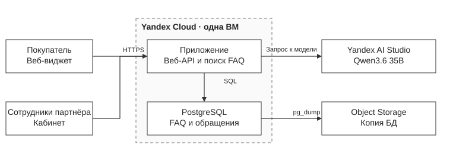
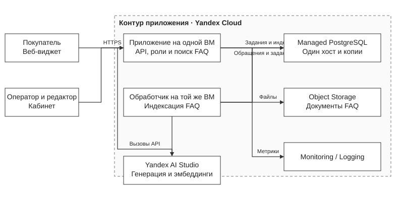
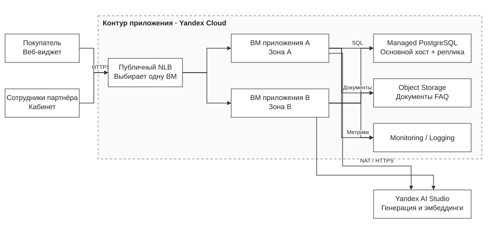
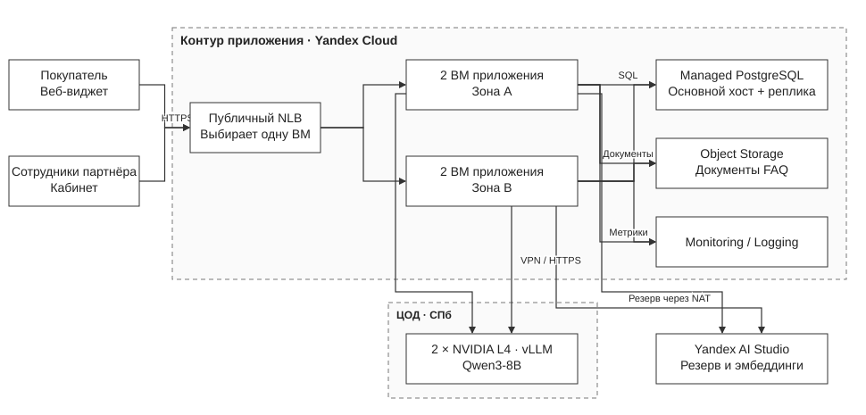
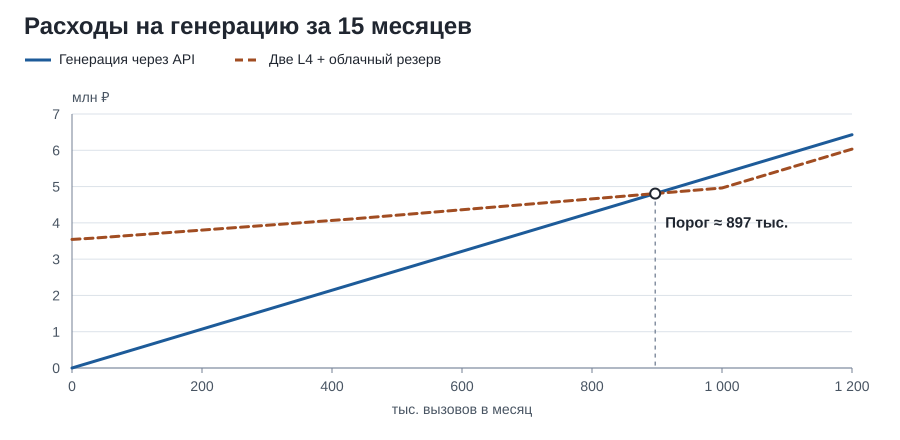
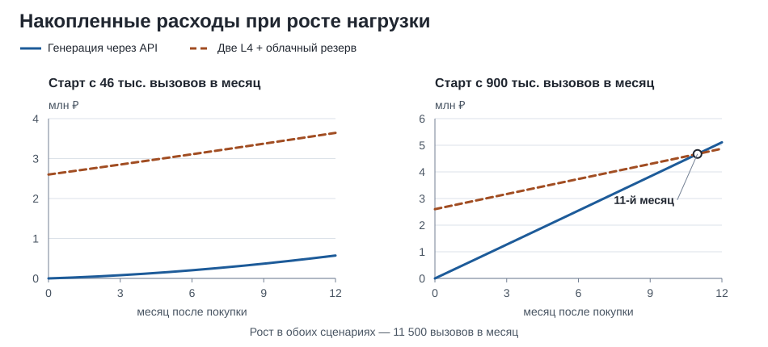

# Лабораторная работа №4. Разработка инфраструктуры MVP AI-приложения

University: [ITMO University](https://itmo.ru/ru/)  
Faculty: [FICT](https://fict.itmo.ru/)  
Course: [Cloud platforms as the basis of technology entrepreneurship](https://github.com/ex-itmo-ict-faculty/cloud-platforms-as-the-basis-of-technology-entrepreneurship)  
Year: 2026/2027  
Group: U4225  
Author: Elchiyan Roman Romanovich  
Lab: Lab4  
Date of create: 05.11.2026\
Date of finished: 09.11.2026

## 1. FAQ AI-система и расчётная нагрузка

**FAQ AI-система** принимает текстовые обращения клиентов малого и среднего бизнеса в Санкт-Петербурге. Виджет отвечает по утверждённой базе знаний или передаёт обращение оператору с темой, кратким контекстом и ссылками на инструкции.

В границы проекта входят текстовые обращения и документы базы знаний. Цель работы — подобрать инфраструктуру и оценить стоимость содержания прототипа, пилота и промышленной версии.

### 1.1. Обработка обращений и обновление базы знаний

1. Виджет передаёт вопрос по HTTPS. Сервер определяет компанию по проверенному идентификатору виджета и привязывает к ней сеанс. Для сотрудников компания и роль берутся из серверной сессии.
2. Приложение маскирует телефоны, почту, номера заказов и другие распознаваемые идентификаторы. Поиск сначала ограничивается компанией и опубликованной версией базы знаний. PostgreSQL хранит статьи и их векторы. Векторы утверждённых материалов и допустимых запросов строит модель эмбеддингов AI Studio. Полнотекстовый поиск помогает при точных совпадениях, а векторный — при перефразировке. Перед вызовом генерации или эмбеддингов текст проходит проверку по правилам раздела 5.2. [Векторный поиск в Managed PostgreSQL](https://yandex.cloud/ru/docs/managed-postgresql/operations/extensions/vector)
3. Модель сопоставляет смысл вопроса с найденными фрагментами, выбирает источник или возвращает признак отсутствия ответа. Сервис проверяет, что фрагмент взят из разрешённой версии базы, и отправляет клиенту утверждённый текст. Свободно сформулированный ответ используется как черновик для оператора. Порог качества поиска настраивается на размеченных вопросах. Сервис передаёт обращение оператору, если поиск не дал подходящего результата, источники противоречат друг другу, тема требует ручного ответа, клиент просит оператора или истекло время ожидания. Ошибки выбора источника отслеживаются на контрольных вопросах и при разборе обращений.
4. В кабинете оператор получает тему, текст обращения и найденные инструкции. Модель может подготовить выжимку и черновик. При сбое API карточка создаётся по шаблону, а поиск по ключевым словам остаётся доступным. Повторная отправка запроса с тем же ключом не создаёт новый тикет.
5. Партнёр передаёт актуальные правила и назначает ответственного, например руководителя поддержки. Команда сервиса убирает дубли и персональные данные, преобразует документы в статьи, отмечает исключения и готовит контрольные вопросы. Ответственный у партнёра сверяет факты и подтверждает публикацию в кабинете. Поддержка модели, промптов, поиска и индекса остаётся у команды сервиса.
6. Приложение индексирует новую версию и проверяет ответы на контрольные вопросы. После согласования статьи и завершения проверок версия публикуется. PostgreSQL хранит одно задание на версию. После сбоя обработчик повторяет задание, при необходимости сервис возвращается к предыдущей версии. По списку вопросов без источника команда сервиса готовит предложения для партнёра.

### 1.2. Нагрузка по стадиям

Диалог — одно обращение пользователя. Вызов генерации — один запрос приложения к модели. В одном диалоге учитываются генерация ответа, черновик для оператора и повторы, когда они требуются. Нагрузка рассчитана на 20 рабочих дней в месяц. Прототип получает 30 обращений в день, пилот и промышленная версия — по 100 обращений в день на партнёра.

| Параметр | Прототип | Пилот | Production |
| --- | ---: | ---: | ---: |
| Компаний | 1 демонстрационная | 3 | 20 |
| Обращений в месяц | 600 | 6 000 | 40 000 |
| Пиковая нагрузка приложения, HTTP-запросов/с | 1 | 3 | 12 |
| Пиковая нагрузка модели, вызовов генерации/с | 1 | 1 | 3 |
| Вызовов модели на обращение, клиент / оператор / повтор | 0,75 / 0,15 / 0,05 | 0,80 / 0,25 / 0,05 | 0,85 / 0,25 / 0,05 |
| Вызовов модели в месяц | 570 | 6 600 | 46 000 |
| Средний вход / выход на вызов, токенов | 2 000 / 250 | 2 000 / 250 | 2 000 / 250 |
| Токенов на эмбеддинг запроса, в среднем на обращение | 150 | 150 | 150 |
| Токенов индексации документов в месяц | 200 000 | 1 000 000 | 8 000 000 |
| Средний занятый объём Object Storage, ГБ | 5 | 20 | 100 |
| Входящий + исходящий трафик NLB, ГБ/мес. | — | — | 30 |

При 20 партнёрах дневная нагрузка составляет 2 000 диалогов. На пиковые 10 минут приходится 10% дневной нагрузки, или 200 диалогов. Коэффициент кратковременного всплеска — 6. Пик приложения составляет **12 HTTP-запросов/с** (200 / 600 × 6 HTTP-запросов на диалог × 6). Пик генерации составляет **2,3 вызова/с** (200 / 600 × 1,15 × 6). Для подбора ресурсов используется **3 вызова/с**.

#### Тарификация и квота AI Studio

Облако привязано к платёжному аккаунту компании. Приложение вызывает модель через API. Компания оплачивает обработанные токены. У AI Studio есть отдельная подписка «Алиса AI Про для бизнеса» с ежемесячной оплатой рабочих мест сотрудников. Для FAQ-сервиса выбран тариф по токенам, поскольку расходы определяет поток обращений к модели. [Платёжный аккаунт юрлица](https://yandex.cloud/ru/docs/getting-started/legal-entity/registration), [тарифы AI Studio](https://aistudio.yandex.ru/ru/docs/ai-studio/pricing)

| Показатель промышленной конфигурации | Расчёт |
| --- | --- |
| Стоимость генерации в месяц | 46 000 вызовов × 0,475 ₽ = **21 850 ₽** |
| Расчётная потребность в одновременной генерации | 3 вызова/с × 2 с = **6 одновременных вызовов** при средней расчётной длительности 2 с |
| Квота синхронного API при оплате по токенам без подписки | **10 одновременных вызовов**, расчётный запас — **4** |

Обе реплики приложения используют общую квоту. При заполнении очереди генерации обращение передаётся оператору. [Квоты AI Studio](https://aistudio.yandex.ru/ru/docs/ai-studio/concepts/limits)

### 1.3. Выбор модели

Для генерации выбрана **Qwen3.6 35B в Yandex AI Studio**. Идентификатор модели — `gpt://<folder_id>/qwen3.6-35b-a3b`, интерфейс — синхронный Chat Completions API. Qwen3.6 35B выбирает источник в контексте FAQ и готовит русскоязычные черновики. Для типовых запросов отключается режим рассуждений. API работает в российском контуре, стоимость вызовов рассчитана по публичным тарифам. Яндекс предлагает её в качестве замены YandexGPT Lite 5 для быстрых ответов. Профиль токенов включает весь оплачиваемый вывод модели. Качество оценивается на контрольных вопросах по критериям раздела 3. [Каталог моделей](https://aistudio.yandex.ru/ru/docs/ai-studio/concepts/generation/models), [режим рассуждений](https://aistudio.yandex.ru/ru/docs/ai-studio/concepts/generation/chain-of-thought), [сроки поддержки моделей](https://aistudio.yandex.ru/ru/docs/ai-studio/release-notes/deprecations)

**Сравнение тарифов.** При профиле 2 000 входных и 250 выходных токенов вызов Alice AI LLM Flash стоит 0,25 ₽, Qwen3.6 35B — 0,475 ₽. Для сопоставления моделей на пилоте используются одинаковые вопросы, критерии выбора источника и правила передачи оператору. Пример применения контекстной генерации в российской поддержке — YandexGPT у Ralf Ringer, где классификацию и генерацию выполняют отдельные модели. [Тарифы моделей](https://aistudio.yandex.ru/ru/docs/ai-studio/pricing), [кейс Ralf Ringer](https://yandex.cloud/ru/cases/ralf)

## 2. Начальная инфраструктура

[Редактируемый исходник четырёх схем Draw.io](diagrams/faq-ai.drawio)

Одна ВМ с Linux, 2 vCPU, 4 ГБ памяти и SSD на 40 ГБ обслуживает демонстрационную нагрузку. На ней работают приложение и PostgreSQL с индексом FAQ, версиями статей и очередью обращений. TLS завершается на ВМ. База закрыта для публичного доступа и раз в сутки копируется в закрытый бакет. При отказе ВМ пользователю доступна независимая ссылка на поддержку партнёра.

## 3. Тестирование партнёрами

Приложение работает на одной ВМ с 2 vCPU, 4 ГБ памяти и SSD на 30 ГБ. PostgreSQL выделен в управляемый кластер с одним приватным хостом 2 vCPU / 8 ГБ / 40 ГБ SSD. База хранит обращения, индекс и задания индексации. Исходные документы и их версии лежат в закрытом Object Storage. Раздельный доступ обеспечивается проверкой роли, ограничением по компании в приложении и политиками RLS в PostgreSQL. Для каждого запроса контекст компании выставляется внутри транзакции. Роль приложения подчиняется RLS и не владеет таблицами. В Monitoring и Logging поступают задержки, ошибки, число токенов и агрегаты качества без текста обращений.

Автоматические копии PostgreSQL хранятся семь суток. План пилота предусматривает пробное восстановление в отдельный кластер. Для Object Storage включается версионирование и задаётся срок хранения старых версий. Приложение и БД остаются одиночными точками отказа на этой стадии. [Резервные копии Managed PostgreSQL](https://yandex.cloud/ru/docs/managed-postgresql/concepts/backup)

### 3.1. Порядок и критерии пилота

- **Порядок пилота.** Партнёры и команда сервиса размечают типовые вопросы, правильные источники и случаи передачи оператору. Сначала проверяется закрытый набор вопросов, затем в кабинете включаются черновики, а в виджете — автоответы по прошедшим проверку темам.
- **Критерии перехода в промышленную эксплуатацию.** Выборка — не менее 200 случаев от трёх партнёров, включая вопросы без ответа и межклиентские проверки. Не менее 90% корректных автоответов с опорой на источник. В выборке допускается 0 критических ошибок и 0 нарушений изоляции. P95 времени до ответа или передачи оператору — до 6 с при расчётной нагрузке. Обязательны проверка восстановления из копии и проверка работы при отключении AI API.
- **Метрики пилота.** Доля повторных обращений по той же теме за 48 ч, активное время работы оператора, время передачи обращения и доля черновиков без существенной правки. Результаты группируются по темам и партнёрам.

## 4. Промышленная инфраструктура

### 4.1. Основной вариант с генерацией по API

Публичный Network Load Balancer принимает соединения на TCP 443. Для каждого соединения NLB выбирает **одну** из двух ВМ приложения в разных зонах. На выбранной ВМ завершается TLS, выполняется поиск и при необходимости вызывается модель. NLB опрашивает служебный HTTP-порт и направляет новые соединения на доступный экземпляр. Сбой модели переводит приложение в режим ручной обработки. Ключ идемпотентности предотвращает дублирование тикетов при повторной отправке.

Реплики приложения работают с общей PostgreSQL и Object Storage. База состоит из двух приватных хостов по 2 vCPU, 8 ГБ памяти и 40 ГБ SSD. Запись идёт на основной хост. При его отказе роль переходит к реплике, а приложение восстанавливает соединение. Доступ к AI Studio идёт через управляемый NAT-шлюз. [Особенности реализации NLB](https://yandex.cloud/ru/docs/network-load-balancer/concepts/specifics), [проверки доступности](https://yandex.cloud/ru/docs/network-load-balancer/concepts/health-check), [репликация PostgreSQL](https://yandex.cloud/ru/docs/managed-postgresql/concepts/replication)

Каждая реплика рассчитана на полный пик приложения при отказе соседней. Группа включает 2–4 ВМ, две из них работают постоянно. Масштабирование запускается при устойчивом росте загрузки. Две дополнительные ВМ на 120 ч увеличивают расходы на вычисления и диски на **1 055 ₽**. Обновление выполняется поочерёдно, с проверкой готовности и откатом при ошибке. Секреты хранятся в Lockbox, сервисные аккаунты получают минимальные права.

| Событие | Реакция | Проектная цель проверки |
| --- | --- | --- |
| AI API недоступен или превышена квота | Готовые FAQ по ключевым словам, передача оператору с шаблонной карточкой. Генерация отключается по ошибкам и тайм-аутам | Тикет создаётся один раз, есть канал ручного ответа |
| Одна реплика приложения недоступна | NLB направляет трафик на доступную реплику, очередь продолжает обрабатываться | Оставшаяся реплика выдерживает пиковую нагрузку. NLB исключает сбойный узел за 60 с |
| Недоступен основной хост PostgreSQL | Управляемое переключение, переподключение приложения к новому основному хосту | RTO ≤ 15 минут, RPO ≤ 5 минут в тесте отказа хоста |
| Ошибочное удаление или порча БД | Восстановление в новый кластер, проверка выборки и переключение приложения | RTO ≤ 4 ч, RPO ≤ 1 ч для БД при доступных резервных копиях |
| Недоступен регион | Статическая ссылка на канал партнёра | Отдельная региональная репликация отсутствует в проекте |

RTO — время до восстановления обслуживания. RPO — допустимая потеря изменений по времени. Целевой RPO прототипа составляет 24 ч по ежедневной копии. Для пилота целевые RTO и RPO составляют 8 ч и 24 ч соответственно.

### 4.2. Вариант с собственным сервером

Вариант с локальной генерацией использует **Dell PowerEdge R760xa 2U с двумя NVIDIA L4** в ЦОД Санкт-Петербурга. На каждой карте работает экземпляр Qwen3-8B в vLLM. Обе карты используют общие шасси и площадку. Резерв при отказе сервера — Qwen3.6 35B в AI Studio. [Карточка Qwen3-8B](https://huggingface.co/Qwen/Qwen3-8B), [интерфейс vLLM](https://docs.vllm.ai/en/latest/serving/openai_compatible_server/)

Реплика приложения направляет допустимые запросы на сервер по HTTPS через VPN. При переполнении локальной очереди или тайм-ауте запрос переходит в AI Studio в пределах общего времени ответа. Для обеих моделей действуют правила допуска раздела 5.2. При отказе обоих контуров остаются поиск по ключевым словам и передача оператору. PostgreSQL, Object Storage и эмбеддинги остаются в облаке. Разница в расходах на сеть, журналы и сопровождение отражена в разделе 7.

## 5. Стоимость содержания и защита данных

### 5.1. Инфраструктурная смета

Расчётный месяц — 30 дней (720 ч). Суммы приведены в рублях с НДС по тарифам Yandex Cloud на 9 ноября 2026 года. В промышленной конфигурации учтены две постоянно работающие ВМ.

| Ресурс | Формула или ставка | Прототип | Пилот | Production |
| --- | --- | ---: | ---: | ---: |
| Compute Cloud, Linux VM | Число VM × 720 × (2 × 1,24 + 4 × 0,33) | 2 736,00 | 2 736,00 | 5 472,00 |
| SSD приложения | Число VM × 720 × размер диска × 0,0199 | 573,12 | 429,84 | 859,68 |
| Managed PostgreSQL, хосты s3-c2-m8 | Число хостов × 720 × (2 × 1,8792 + 8 × 0,5072) | — | 5 627,52 | 11 255,04 |
| SSD PostgreSQL | Число хостов × 720 × 40 × 0,0198 | — | 570,24 | 1 140,48 |
| Object Storage Standard | (Средний объём − 1 ГБ) × 2,376 | 9,50 | 45,14 | 235,22 |
| Публичный IP приложения | 720 × 0,26352, где VM принимает трафик напрямую | 189,73 | 189,73 | — |
| Публичный NLB | 720 × 0,8564 + 30 ГБ × 0,0659 | — | — | 618,59 |
| NAT-шлюз | 720 × 0,39528 | — | — | 284,60 |
| Qwen3.6 35B, синхронный API | Вызовы × (2 × 0,20 + 0,25 × 0,30) | 270,75 | 3 135,00 | 21 850,00 |
| Эмбеддинги | (Токены запросов + индексации) / 1 000 × 0,0101 | 2,93 | 19,19 | 141,40 |
| **Итого по тарифам** | Округление после сложения | **3 782,04** | **12 752,67** | **41 857,01** |
| Резерв на домен, служебные операции и наблюдаемость | Плановая сумма | 150,00 | 300,00 | 600,00 |
| **Базовый бюджет в месяц** | **Тарифы + резерв** | **3 932,04** | **13 052,67** | **42 457,01** |

Источники ставок и правил расчёта — [Compute Cloud](https://yandex.cloud/ru/docs/compute/pricing), [Managed PostgreSQL](https://yandex.cloud/ru/docs/managed-postgresql/pricing), [Object Storage](https://yandex.cloud/ru/docs/storage/pricing), [VPC](https://yandex.cloud/ru/docs/vpc/pricing), [NLB](https://yandex.cloud/ru/docs/network-load-balancer/pricing), [прайс-лист для РФ со ставками NLB и диска БД](https://storage.yandexcloud.net/cloud-www-assets/blog-assets/ru/posts/2025/11/vat-changes-ru-2025/%D0%A2%D0%B0%D1%80%D0%B8%D1%84%D1%8B_Yandex_%D0%A1loud_RU.pdf), [AI Studio](https://aistudio.yandex.ru/ru/docs/ai-studio/pricing).

**Границы сметы.** Операции Object Storage и исходящий интернет-трафик укладываются в бесплатные объёмы при расчётной нагрузке. Трафик NLB тарифицируется отдельно. Бесплатный объём копий PostgreSQL принят в пределах ёмкости дисков кластера — 40 ГБ на пилоте и 80 ГБ в промышленной версии. Копия прототипа входит в объём бакета. Тестовый кластер на время восстановления, превышение квот хранения, CRM-лицензии и платная поддержка облака находятся за пределами базовой сметы. [Monitoring](https://yandex.cloud/ru/docs/monitoring/pricing), [Cloud Logging](https://yandex.cloud/ru/docs/logging/pricing)

### 5.2. Применимые требования к данным

Партнёр определяет цели и основания обработки клиентских обращений и поручает поставщику обработку по договору. Поставщик выступает оператором данных, которые обрабатывает для собственных целей. Прототип использует синтетические данные.

| Норма | Что предусмотрено | Ответственный и статья сметы |
| --- | --- | --- |
| 152-ФЗ, ст. 6, 18.1 и 22 | Основания обработки и перечень операций закрепляются в документах. Условия обработки и меры защиты входят в договор поручения. До начала обработки публикуется политика и выполняется применимое требование об уведомлении Роскомнадзора. | Партнёр и поставщик. Юридические работы и оформление. |
| 152-ФЗ, ч. 5 ст. 18 и ст. 12 | Базы обращений, журналы и копии размещаются в России. При смене подрядчика применяется то же требование к маршруту данных. | Поставщик и партнёр. Российские площадки и договорная проверка. |
| 149-ФЗ, ст. 16, 152-ФЗ, ст. 19, ПП РФ № 1119 и приказ ФСТЭК № 21 | Уровень защищённости и состав мер определяются по модели угроз. Проект предусматривает MFA сотрудников, изоляцию компаний, приватную БД, закрытые бакеты, TLS и аудит. До пилота оформляются перечень мер и результаты оценки их эффективности. | Поставщик реализует меры, оператор контролирует исполнение. Модель угроз, секреты, журналы и оценка защиты. |
| 152-ФЗ, ст. 21 | Данные удаляются по сроку хранения с учётом версий и копий. При восстановлении применяется журнал удалений. При инциденте по ч. 3.1 оператор уведомляет Роскомнадзор в течение 24 часов и сообщает результаты расследования в течение 72 часов. | Партнёр направляет уведомление, поставщик помогает расследовать инцидент. Журналы, копии и сопровождение. |
| Закон № 2300‑1, ст. 8–10, для B2C-партнёров | Ответы об условиях продажи и обслуживания опираются на утверждённые сведения партнёра. В спорных случаях доступен оператор. | Партнёр отвечает за содержание, поставщик поддерживает публикацию и передачу обращения. Работы с базой знаний. |
| 243-ФЗ от 26.07.2026 | Статьи 9–10 вступают в силу 1 марта 2027 года. Закрытый FAQ-диалог находится вне сценария публикации на пользовательских страницах по ч. 2 ст. 9. Виджет обозначает автоматический ответ и позволяет обратиться к оператору. | Поставщик и партнёр. Проверка прав на материалы и условий работы с моделями. |

[152-ФЗ](https://pravo.gov.ru/proxy/ips/?docbody=&nd=102108261), [149-ФЗ](https://www.consultant.ru/document/cons_doc_LAW_61798/), [ПП РФ № 1119](https://www.consultant.ru/document/cons_doc_LAW_137356/), [приказ ФСТЭК № 21](https://minjust.consultant.ru/documents/6146?items=10), [Закон № 2300‑1](https://www.consultant.ru/document/cons_doc_LAW_305/), [243-ФЗ](https://www.consultant.ru/document/cons_doc_LAW_540336/).

**Поток данных в AI Studio.** По документации Яндекса модели Model Gallery работают в российских зонах Yandex Cloud. Запросы к моделям сторонних разработчиков из каталога обрабатываются внутри этого контура. В проекте используется синхронный Chat Completions API. История диалогов и индекс FAQ остаются в нашем контуре. Для вызовов генерации и эмбеддингов отключается запись содержимого через `x-data-logging-enabled: false`. Трейсинг промптов и API с облачным хранением истории отключены. После отключения логирования специальные условия (пп. 5.5–5.6) допускают кратковременное хранение содержимого, необходимое для обработки запроса. У Яндекса остаются технические и аудитные события без текста запросов и ответов. [Размещение моделей](https://aistudio.yandex.ru/ru/security), [политика хранения](https://aistudio.yandex.ru/ru/docs/ai-studio/concepts/security/data-storage), [отключение логирования](https://aistudio.yandex.ru/ru/docs/ai-studio/operations/disable-logging)

Модель получает только необходимые фрагменты опубликованного FAQ и проверенный текст. Маскирование сокращает объём передаваемых данных. Обращения, для ответа на которые нужны персональные данные заказа, направляются оператору. Правила допуска исключают специальные категории данных, биометрию и охраняемую законом тайну. Российское размещение модели подтверждает маршрут обработки. Категории национальных и суверенных моделей определены в ст. 6 243-ФЗ. Договорная цепочка, регион и сроки хранения согласуются до начала обработки реальных данных. Проектные сроки хранения составляют 30 дней для диалогов, 14 дней для технических журналов, 7 дней для копий PostgreSQL на пилоте и 14 дней в промышленной версии. [Условия Yandex Cloud](https://yandex.ru/legal/cloud_termsofuse/ru/), [специальные условия AI Studio](https://yandex.ru/legal/cloud_terms_yandex_ai_studio/ru/)

### 5.3. Расходы на защиту

В таблице приведены разовые и ежемесячные расходы на защиту для пилота и промышленной эксплуатации.

| Статья | Расчёт | Стоимость |
| --- | --- | ---: |
| Документы, договорные условия и уведомления | 12 ч × 2 500 ₽/ч | 30 000 ₽ разово |
| Модель угроз и оценка защиты | 40 ч × 1 096,875 ₽/ч. Определение уровня защищённости, проверка мер, протокол оценки эффективности | 43 875 ₽ разово |
| Текущая защита на пилоте | 2 ч/мес. инженера и 500 ₽/мес. на секреты, доставку событий и хранение журналов защиты | 2 694 ₽/мес. |
| Текущая защита в промышленной эксплуатации | 4 ч/мес. инженера и 1 500 ₽/мес. на те же сервисы и хранение журналов защиты | 5 888 ₽/мес. |
| Дополнительные меры для собственного GPU | 8 ч разово на изоляцию, шифрование и проверку доступа, затем 2 ч/мес. на проверку локального контура | 8 775 ₽ разово и 2 194 ₽/мес., входят в смету раздела 7 |

Бюджет с защитой составляет **15 746 ₽/мес. на пилоте** и **48 345 ₽/мес. в промышленной облачной конфигурации**. Разовая подготовка — **73 875 ₽**. Внешняя оценка, специальные средства защиты и отраслевые требования образуют отдельные статьи сметы при применимости. Состав мер определяется моделью угроз и отраслью партнёра. В этой таблице учтены журналы защиты, метрики приложения входят в смету раздела 5.1. [Тарифы Lockbox](https://yandex.cloud/ru/docs/lockbox/pricing), [тарифы Audit Trails](https://yandex.cloud/ru/docs/audit-trails/pricing)

## 6. Экономическое обоснование FAQ AI-системы

### 6.1. Стоимость часа оператора в Санкт-Петербурге

Выборка hh.ru от 9 ноября 2026 года. Санкт-Петербург, полная занятость, указанный доход, запрос «чат поддержка», сортировка по возрастанию и убыванию зарплаты. В выборку вошли пять вакансий письменной или смешанной поддержки с двусторонней зарплатной вилкой. Исключены дубли, руководящие роли, продажи и вакансии с доплатой за подключение услуг. [По возрастанию](https://spb.hh.ru/search/vacancy?area=2&only_with_salary=true&employment=full&order_by=salary_asc&text=%D1%87%D0%B0%D1%82%20%D0%BF%D0%BE%D0%B4%D0%B4%D0%B5%D1%80%D0%B6%D0%BA%D0%B0), [по убыванию](https://spb.hh.ru/search/vacancy?area=2&only_with_salary=true&employment=full&order_by=salary_desc&text=%D1%87%D0%B0%D1%82%20%D0%BF%D0%BE%D0%B4%D0%B4%D0%B5%D1%80%D0%B6%D0%BA%D0%B0)

| Вакансия | Дата | Вилка, ₽/мес. | Середина до НДФЛ, ₽/мес. |
| --- | --- | ---: | ---: |
| [РИВ ГОШ, чат-поддержка](https://spb.hh.ru/vacancy/138116856) | 08.11.2026 | 42 000–57 000 на руки | 56 897 |
| [Система Геткурс, клиентская поддержка](https://spb.hh.ru/vacancy/134448870) | 07.11.2026 | 52 000–62 900 до НДФЛ | 57 450 |
| [МК Групп, поддержка пользователей](https://spb.hh.ru/vacancy/138983124) | 07.11.2026 | 45 000–60 000 на руки | 60 345 |
| [Финансовый Кластер, письменная поддержка](https://spb.hh.ru/vacancy/138983196) | 06.11.2026 | 70 000–77 000 на руки | 84 483 |
| [Трофимова, чаты и звонки](https://spb.hh.ru/vacancy/139039555) | 07.11.2026 | 61 000–95 000 на руки | 89 655 |
| **Медиана пяти середин** | | | **60 345** |

Медиана пяти середин зарплатных вилок — **60 345 ₽/мес. до НДФЛ**. Зарплаты на руки приведены к суммам до НДФЛ делением на 0,87. Стоимость часа для работодателя по выборке — **490 ₽** (60 345 × 1,30 / 160), без доплат и взносов на травматизм. [НДФЛ и страховые взносы ФНС](https://www.nalog.gov.ru/html/sites/www.rn77.nalog.ru/2025/2kv2025/presentacii/IPSYSTEM.pdf), [тарифы взносов ФНС](https://www.nalog.gov.ru/rn77/taxation/insprem/)

Для сверки карточка hh.ru по Санкт-Петербургу показывает медиану **60 302 ₽/мес.** без явного указания налоговой базы. Диапазон **55 680–60 000 ₽** относится к 102 вакансиям на диаграмме распределения. Checkroi приводит **55 775 ₽ на руки** для первой линии в своей выборке по России. Это даёт около **521 ₽/ч** при той же методике. В городской выборке Checkroi из 100 вакансий разных уровней медиана составляет 85 000 ₽ на руки. ГородРабот показывает **80 000 ₽/мес.** в сентябре 2026 года по более широкой категории технической поддержки в Петербурге. Ставка сметы получена по прямым местным вакансиям. [hh.ru Карьера](https://career.hh.ru/profession/69), [Checkroi](https://checkroi.ru/blog/zarplata-spetsialista-tehpodderzhki/), [ГородРабот](https://sankt-peterburg.gorodrabot.ru/salaries/sotrudnik-tehnicheskoy-podderzhki)

### 6.2. Эффект для одной службы поддержки

Пример рассчитан на **2 000 диалогов в месяц на партнёра**, как в production. Самообслуживание — завершение без участия оператора и без повторного обращения по той же теме в течение 48 часов. Помощь оператору — сокращение активного времени по обращениям, которые он завершает сам. В это время входят поиск инструкции, чтение резюме, проверка и правка черновика. Скорость передачи в нужную очередь и частота повторов учитываются отдельными метриками.

| Сценарий | Самообслуживание, доля всех / минуты на случай | Помощь оператору, доля всех / выигрыш минут | Высвобождено, ч/мес. | Оценка времени по 490 ₽/ч | Доля часов, превращаемых в экономию | Денежная экономия на труде |
| --- | ---: | ---: | ---: | ---: | ---: | ---: |
| Нижний | 15% / 4 | 25% / 1,0 | 28,3 | 13,9 тыс. ₽ | 20% | 2,8 тыс. ₽ |
| Базовый | 30% / 4,5 | 40% / 1,8 | 69,0 | 33,8 тыс. ₽ | 50% | 16,9 тыс. ₽ |
| Верхний | 45% / 5 | 40% / 2,5 | 108,3 | 53,1 тыс. ₽ | 70% | 37,2 тыс. ₽ |

Высвобожденные часы равны числу диалогов, умноженному на сумму произведений долей на сэкономленные минуты, с делением на 60. В базовом сценарии самообслуживание высвобождает 45 ч, помощь оператору — 24 ч. Денежная экономия соответствует сокращению оплачиваемых сверхурочных, подрядных часов или найма. При сохранении графика и штата высвобождённое время увеличивает доступную ёмкость поддержки. Сценарные доли и минуты оцениваются на пилоте по сопоставимым темам и сменам. Исследование Generative AI at Work описывает эффект подсказок для операторов. [Generative AI at Work](https://doi.org/10.1093/qje/qjae044)

Для базы знаний на пилоте измеряются время поиска пробелов, подготовки и утверждения статьи, а также число повторяющихся вопросов без источника. Группировку вопросов и подготовку материалов выполняет команда сервиса. Бюджет партнёра — 8 ч на приёмку, 4 ч/мес. на согласование по ставке 800 ₽/ч. Экономия времени на работе с базой знаний учитывается отдельно от времени операторов.

### 6.3. Ставка AI-разработчика

В трудозатраты AI-разработчика входят настройка поиска по базе знаний, интеграция модели и проверка ответов по найденным источникам. В петербургской выдаче hh.ru КВС указывает **200 000 ₽ до НДФЛ** для AI Engineer с опытом 1–3 года. В Новосибирске АО «ЭДС» предлагает ML-инженеру LLM с опытом 3–6 лет **от 400 000 ₽ на руки** для более широкой роли с локальной инфраструктурой. Хабр Карьера приводит для ML-инженеров в Петербурге ориентиры **180–250 тыс. ₽ для middle** и **300–420 тыс. ₽ для senior** в месяц по данным 2025–2026 годов. Вакансии приведены как примеры, диапазон Хабр Карьеры охватывает ML-роли шире нашего профиля. [КВС на hh.ru](https://spb.hh.ru/employer/690362?hhtmFrom=article), [выдача hh.ru с АО «ЭДС»](https://spb.hh.ru/search/vacancy?L_save_area=true&enable_snippets=false&hhtmFrom=vacancy_search_list&page=2&search_field=company_name&search_field=description&search_field=name&search_session_id=84dd7e05-12bb-492e-ac3a-0447cffb2f0d&text=ML-%D0%B8%D0%BD%D0%B6%D0%B5%D0%BD%D0%B5%D1%80), [Хабр Карьера](https://career.habr.com/professions/ml-inzhener)

В смете принято **350 000 ₽ до НДФЛ за полную занятость AI-разработчика**. Для расчёта часовой ставки годовой оклад 4,2 млн ₽ увеличивается на взносы по общему тарифу 2026 года. Для части оклада до 2,979 млн ₽ применяются 30%, сверх неё — 15,1%. В смете на травматизм принято 0,2%. Средняя стоимость полной занятости для работодателя — около **440,5 тыс. ₽/мес.**, или **2 753 ₽/ч** при 160 оплачиваемых часах. В таблице используем 2 750 ₽/ч и учитываем только часы, выделенные на проект. [Предельная база и тарифы ФНС](https://www.nalog.gov.ru/rn77/news/activities_fts/16577139/)

### 6.4. Порог покрытия затрат

| Статья поставщика | Расчёт | Сумма |
| --- | --- | ---: |
| Разработка общего сервиса | Backend 80 ч × 2 200 ₽, AI 48 ч × 2 750 ₽, DevOps 40 ч × 1 100 ₽, QA 32 ч × 1 400 ₽ | 396 800 ₽ разово |
| Подготовка защиты | Документы, модель угроз и оценка защиты из раздела 5 | 73 875 ₽ разово |
| Работа сооснователей до запуска | Один месяц на согласование с партнёрами, управление разработкой и приёмку | 332 010 ₽ разово |
| Облако и текущая защита при 20 партнёрах | Смета раздела 5, включая 4 ч инженера по защите | 48 345 ₽/мес. |
| ФОТ команды сопровождения | Backend 12 ч × 2 200 ₽, AI 12 ч × 2 750 ₽, DevOps 12 ч × 1 100 ₽, QA 12 ч × 1 400 ₽, учёт и документооборот 12 ч × 1 100 ₽ | 102 600 ₽/мес. |
| ФОТ двух сооснователей | 175 000 ₽ + 80 000 ₽ до НДФЛ, 30% страховых взносов и 0,2% взносов на травматизм для принятого класса риска | 332 010 ₽/мес. |
| Привлечение партнёров | Сметный резерв на продвижение | 8 000 ₽/мес. |
| **Общие расходы при 20 партнёрах** | **Облако, защита, команда, сооснователи и привлечение** | **490 955 ₽/мес.** |
| Подключение одного партнёра | Подготовка материалов 8 ч × 900 ₽, проверка 2 ч × 1 400 ₽, настройка AI 2 ч × 2 750 ₽ | 15 500 ₽ разово |
| Сопровождение одной базы | Обновления и разбор пропусков 4 ч × 900 ₽, проверка 0,5 ч × 1 400 ₽ | 4 300 ₽/мес. |

В проекте два сооснователя на частичной занятости. Первый отвечает за продукт, качество и приёмку технических решений, второй — за партнёров, продажи и внедрение. Оклад технического сооснователя — **175 000 ₽ до НДФЛ за половину рабочего времени**, по ориентиру полной ставки опытного AI-инженера. Оклад коммерческого сооснователя — **80 000 ₽ до НДФЛ** при частичной занятости, сценарная ставка. В часы разработки входят задачи реализации, выделенные другим исполнителям. Технический сооснователь отвечает за решения и приёмку, без повторного учёта часов реализации. НДФЛ удерживается из начисленной зарплаты, страховые взносы добавляются к расходам компании. При 20 партнёрах регулярные затраты на труд составляют около **525,0 тыс. ₽/мес.**, включая сооснователей, сопровождение баз и инженера по защите. [Общие тарифы страховых взносов ФНС](https://www.nalog.gov.ru/rn77/news/activities_fts/16577139/)

Часовые ставки включают нагрузку на ФОТ. Рыночные ориентиры для backend и QA — данные Хабр Карьеры, для сопровождения — петербургские вакансии Linux/DevOps. Часы команды и бюджет привлечения заданы сметой. Нижняя цена рассчитана до маржи и налогов на финансовый результат. [Хабр Карьера, первое полугодие 2026](https://habr.com/ru/specials/1060148/), [backend в Петербурге](https://career.habr.com/professions/backend-razrabotchik), [QA](https://career.habr.com/professions/testirovshchik-avtomatizator), [Linux/DevOps на hh.ru](https://spb.hh.ru/vacancies/sistemnyj-administrator-linux-devops)

При 20 активных партнёрах и возврате затрат на запуск за 12 месяцев нижняя цена покрытия равна **33,5 тыс. ₽/мес. на партнёра**. Расчёт на месяц и на партнёра — (490 955 ₽ + 802 685 ₽ / 12) / 20 + 15 500 ₽ / 12 + 4 300 ₽. Максимальная цена для клиента — денежная экономия из таблицы минус **3,2 тыс. ₽/мес.** на согласование и **0,53 тыс. ₽/мес.** на возврат затрат приёмки за тот же год.

| Сценарий | Порог покрытия поставщика | Верхняя цена для партнёра | Результат |
| --- | ---: | ---: | --- |
| Нижний | 33,5 тыс. ₽/мес. | Денежной экономии не хватает на внутренние затраты | Диапазона цены нет |
| Базовый | 33,5 тыс. ₽/мес. | 13,2 тыс. ₽/мес. | Разрыв около 20,3 тыс. ₽/мес. |
| Верхний | 33,5 тыс. ₽/мес. | 33,4 тыс. ₽/мес. | Почти равные границы. Запаса на маржу нет |

При 2 000 диалогов базовый сценарий даёт предел цены 13,2 тыс. ₽/мес. при себестоимости 33,5 тыс. ₽/мес. При денежном эффекте от половины высвобожденных часов порог покрытия составляет **около 4,6 тыс. диалогов в месяц на партнёра**. В расчёте порога расходы на генерацию и эмбеддинги увеличиваются пропорционально объёму обращений. Состав команды и облачных ресурсов фиксирован.

При ставке технического сооснователя от 150 до 210 тыс. ₽ до НДФЛ за половину времени нижняя цена составляет **31,7–36,0 тыс. ₽/мес.** При базовом окладе сооснователей и росте затрат на труд остальных ролей на 20% нижняя цена составляет около **36,0 тыс. ₽/мес.**

## 7. Условия перехода на собственный сервер

### 7.1. Стоимость двух вариантов

Сравниваются **все вызовы через API** и **сервер 2U с двумя NVIDIA L4 в ЦОД Санкт-Петербурга, с API для пиков и отказов**. Тариф Qwen3.6 35B составляет 0,20 ₽ за 1 000 входных и 0,30 ₽ за 1 000 выходных токенов. При 2 000 входных и 250 выходных токенах базовый вызов стоит **0,475 ₽ с НДС**. Ставка относится к вызову без скидки за кеширование. Для обеих конфигураций показаны денежные расходы по публичным ценам с учётом применимого НДС, без налоговых вычетов. [Тарифы AI Studio](https://aistudio.yandex.ru/ru/docs/ai-studio/pricing)

| Статья | Расчёт | Сумма |
| --- | --- | ---: |
| Сервер и ускорители | Dell PowerEdge R760xa 2U от 1 450 000 ₽ и 2 × 507 194 ₽ за NVIDIA L4 24 ГБ | 2 464 388 ₽ |
| Доставка, монтаж и ввод | 10 000 ₽ логистика и монтаж, 28 ч инженера по 1 096,875 ₽, из них 8 ч на защиту | 40 713 ₽ |
| **Покупка и ввод** | | **2 505 101 ₽** |
| Колокация и питание | 10 858 ₽ за 2U с лимитом БП 550 Вт, плюс 15 860 ₽ за 1 кВт и 9 × 1 830 ₽ за дополнительные 100 Вт | 43 188 ₽/мес. |
| Сопровождение | 7 ч инженера по 1 096,875 ₽, из них 2 ч на защиту | 7 678 ₽/мес. |
| Доступ, сеть, журналы и работы на площадке | 732 ₽ за IPMI, 488 ₽ за вторую розетку, 780 ₽ резерв на связь, журналы и работы сверх тарифа | 2 000 ₽/мес. |
| Резерв ремонта | 1% от цены оборудования в год, округлённо | 2 054 ₽/мес. |
| **Первый месяц, до вызовов API** | | **54 920 ₽** |

Цена R760xa в смете соответствует опубликованной цене базовой конфигурации. Размещение рассчитано по прайсу ФИЛАНКО на 2U и номинал одного БП 2 400 Вт. Дополнительная мощность округлена до 100 Вт вверх. Комплектация, учёт двух вводов и применимый НДС зависят от коммерческого предложения. [Dell, совместимость ускорителей](https://www.dell.com/en-us/infohub/articles/poweredge-xs-vs-standard-vs-xa-vs-xd2), [характеристики БП](https://www.dell.com/support/manuals/en-si/oth-r760xa/r760xa_ism_pub/psu-specifications?guid=guid-2ebf92fd-db27-464f-b853-d8b7b93e8ec1&lang=en-us), [Serverline](https://serverline.tech/catalog/good?alias=poweredge-760xa&id=166), [Сервер Центр](https://server-center.ru/products/graficeskii-uskoritel-nvidia-l4-24gb-gddr6-900-2g193-0000-001), [ФИЛАНКО](https://datahouse.spb.ru/arenda-unitov/)

### 7.2. Нагрузка и доля локальной генерации

В открытом тесте Qwen3-8B на L4 с vLLM получено около 228 выходных токенов/с на карту при двух запросах/с и профиле 512 входных / 128 выходных токенов. При четырёх запросах/с медианная задержка первого токена выросла с 233 мс до 8,3 с. Медианное время между токенами при двух запросах/с — около 89 мс. При коэффициенте 0,70 к опубликованной скорости две L4 дают **1,28 вызова/с**, или **до 735 тыс. вызовов за 160 ч** при 250 токенах на ответ. Проектный критерий для локальной генерации — P95 до 6 с на профиле 2 000/250. Замер на профиле 512/128 используется для оценки пропускной способности. Для Qwen3.5-9B применяется отдельная оценка производительности. [Замеры на NVIDIA L4](https://aiengineeringfromscratch.com/manual-vllm-101/ref-lab-notes#l4-rate-requests-each-second-512-prompt-and-128-output-tokens), [Qwen3.5-9B](https://huggingface.co/Qwen/Qwen3.5-9B)

Профиль нагрузки — 20 рабочих дней по 8 ч. В пиковые 10 минут поступает 10% дневных вызовов. В первую минуту их интенсивность в шесть раз выше средней по этому окну. Оставшиеся вызовы пикового окна распределены по следующим девяти минутам. Остальные 90% дневных вызовов равномерно распределены по оставшейся смене. В базовом сценарии 80% вызовов пригодны для локальной обработки по данным, качеству и задержке. За каждый интервал локально учитываются вызовы в пределах пропускной способности двух L4. Остальные вызовы оплачиваются по тарифу API. Ёмкость одной L4 за 160 ч — до 368 тыс. вызовов. При этой ёмкости годовая экономия на API меньше стоимости конфигурации с тем же шасси и одной картой.

При 800 тыс. вызовов в месяц две L4 обрабатывают около **592 тыс. вызовов**, или 74%. Расчётный всплеск — **40 вызовов/с**. Резерв на отказ сервера составляет **80 одновременных облачных генераций** при средней длительности вызова 2 с. Для такого объёма требуется увеличение квоты AI Studio относительно базовых 10. Графики сравнивают статьи, которые различаются между вариантами. Для обеих конфигураций принят одинаковый состав приложения, БД и хранилища при одном и том же объёме. Сеть, журналы и сопровождение GPU учтены отдельно.

### 7.3. Индексация и порог

Первый месяц рассчитан по тарифам ноября 2026 года. Прогноз Банка России — **7,1–7,6% инфляции на конец 2026 года** и **4% на конец 2027 года**. В базовом расчёте эксплуатационные расходы индексируются на 4% годовых, размещение — на 10% по отраслевому сценарию 3data/iKS-Consulting. Стресс-сценарий размещения — **31,3% годовых**, рост цены стандартной стойки 5 кВт в Петербурге во II квартале 2026 года к тому же кварталу 2025-го. Тариф API в базовом сценарии постоянен. Ставка дисконтирования — **14% годовых**, ориентир — ключевая ставка Банка России. [Прогноз Банка России](https://www.cbr.ru/dkp/mp_dec/decision_key_rate/comment_05112026/), [ключевая ставка](https://www.cbr.ru/hd_base/KeyRate/), [3data/iKS-Consulting](https://3data.ru/activities/3dci), [данные по Петербургу](https://www.kommersant.ru/doc/8863421)

Месячные расходы облачного варианта равны произведению тарифа на все вызовы. В серверном варианте учитываются покупка в нулевом месяце, эксплуатация и оплата вызовов, оставшихся в облаке. Расходы месяца m дисконтируются делением на 1,14 в степени m/12. Коэффициент индексации — (1 + годовой темп) в степени (m − 1)/12. Месяц возврата вложений соответствует пересечению кривых приведённых накопленных расходов. [C. Fisher, Cloud versus On-Premise Computing](https://doi.org/10.4236/ajibm.2018.89133)

При постоянной нагрузке годовой порог составляет **около 800 тыс. вызовов в месяц**, или **696 тыс. диалогов** при 1,15 вызова на диалог. При 805 тыс. вызовов приведённые расходы за год составляют **4,28 млн ₽ через API** и **4,26 млн ₽ с сервером**. Разница по неокруглённым значениям — около 18 тыс. ₽.

Пять новых партнёров с 2 000 диалогов на каждого увеличивают месячную нагрузку на **11 500 вызовов**. При старте с 46 тыс. вызовов к двенадцатому месяцу нагрузка достигает 172,5 тыс. вызовов, срок возврата превышает год. Минимальная траектория для возврата за год — **739 тыс. вызовов в первом месяце и 865 тыс. в двенадцатом**. При старте с 805 тыс. вызовов кривые пересекаются на **11-м месяце**.

| Сценарий на 12 месяцев | Порог при постоянном объёме |
| --- | ---: |
| Базовый сценарий, оборудование остаётся в эксплуатации | **800 тыс. вызовов/мес.** |
| Индексация размещения 31,3% годовых | **812 тыс. вызовов/мес.** |
| Тариф API ниже на 20% | Две L4 не возвращают вложения даже при расчётной предельной загрузке. При цене Alice AI LLM Flash порог также недостижим |
| Эффективная скорость L4 ниже базовой оценки на 20% | Две L4 не возвращают вложения даже при расчётной предельной загрузке |
| Стоимость владения при продаже через год | Около **525 тыс. вызовов/мес.** при сценарной чистой выручке 1,20 млн ₽ |

Оценка выручки от продажи через год — 1,25 млн ₽ (750 тыс. ₽ за сервер и по 250 тыс. ₽ за карту). Ориентир для сервера — цена б/у Dell R750, для L4 — сценарная доля цены новой карты. После 50 тыс. ₽ на демонтаж, логистику и продажу чистая выручка составляет **1,20 млн ₽**. В расчёте стоимости владения эта сумма дисконтируется и вычитается из расходов в конце года. [Предложение б/у Dell R750](https://b2bay.ru/product/R750/)

## 8. Вывод

Для FAQ AI-системы выбран поэтапный переход от одной ВМ к резервируемой архитектуре с генерацией по API. Резервирование оправдано после приёмки пилота по качеству ответов и изоляции данных. Условие промышленного запуска — обслуживание расчётной нагрузки одной ВМ при отказе соседней и восстановление в пределах целевых сроков. Собственный GPU предусмотрен как вариант промышленной конфигурации при достижении расчётного порога.
